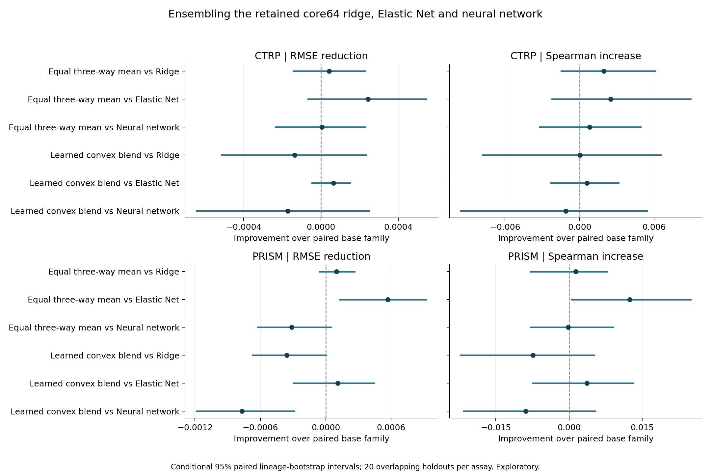
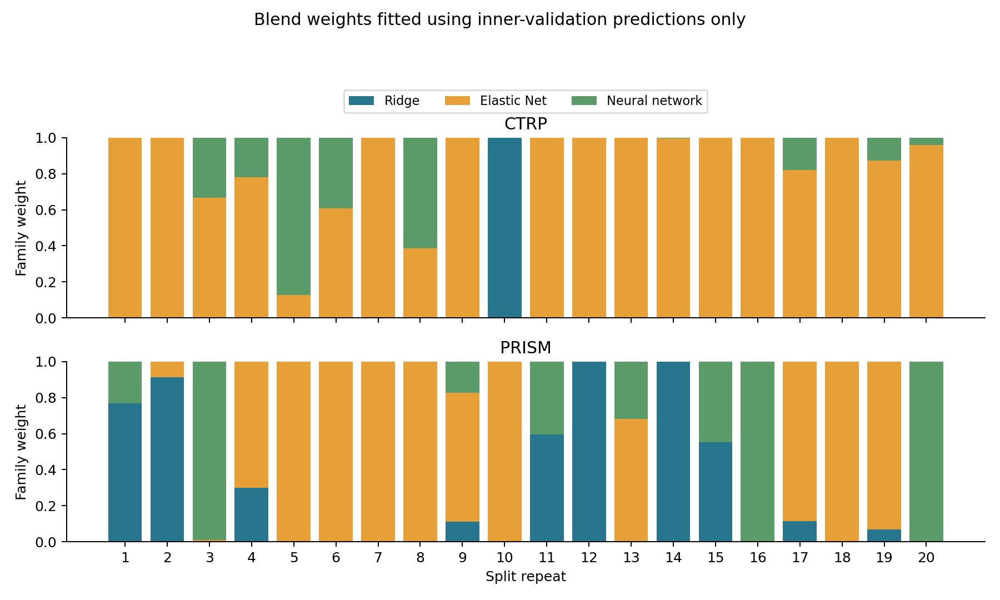

# Ensemble of the retained 64-gene models

All original 64 genes and the 120 saved outer ridge/Elastic Net/neural-network models are retained unchanged. The NN is its original three-network mean and contributes as one model family. CTRP and PRISM remain separate.

Two ensemble rules are tested: an equal three-family mean and a convex blend with nonnegative weights summing to one. The blend has no intercept, calibration or clipping and may assign zero to a family. An inner-selected single-family control tests whether blending helps beyond choosing a family.

## Findings

**No convincing gain over the retained neural network was established.** The equal mean has a negligible CTRP RMSE edge with an interval spanning zero and slightly higher mean PRISM error. Learned weights give higher mean error in both assays; PRISM is worse than the NN and the equal mean under the conditional intervals. Keep the retained registry unchanged.

| Assay | Ensemble | RMSE reduction vs NN | Conditional 95% interval | Favorable repeats /20 |
|---|---|---:|---:|---:|
| CTRP | Equal three-way mean | +0.000005 | [-0.000235, +0.000228] | 12 |
| CTRP | Learned convex blend | -0.000173 | [-0.000643, +0.000248] | 11 |
| PRISM | Equal three-way mean | -0.000312 | [-0.000627, +0.000049] | 5 |
| PRISM | Learned convex blend | -0.000768 | [-0.001185, -0.000290] | 4 |

Both blends outperform the inner-selected single-family control under conditional RMSE intervals. That control itself has higher mean error than the retained NN. Outperformance of this selection-only control does not establish a gain over each retained family.

## Held-out performance

| Assay | Procedure | RMSE | Spearman | R2 | Equal-lineage RMSE |
|---|---|---:|---:|---:|---:|
| CTRP | Ridge | 0.117005 | 0.4606 | 0.2087 | 0.110655 |
| CTRP | Elastic Net | 0.117205 | 0.4600 | 0.2062 | 0.111193 |
| CTRP | Neural network | 0.116968 | 0.4618 | 0.2094 | 0.110514 |
| CTRP | Equal three-way mean | 0.116963 | 0.4626 | 0.2094 | 0.110703 |
| CTRP | Learned convex blend | 0.117141 | 0.4606 | 0.2070 | 0.111117 |
| CTRP | Inner-selected single family | 0.117247 | 0.4582 | 0.2056 | 0.111254 |
| CTRP | Training mean | 0.132083 | undefined | -0.0062 | 0.120777 |
| PRISM | Ridge | 0.138611 | 0.3601 | 0.0514 | 0.109207 |
| PRISM | Elastic Net | 0.139082 | 0.3491 | 0.0450 | 0.109586 |
| PRISM | Neural network | 0.138203 | 0.3616 | 0.0569 | 0.108525 |
| PRISM | Equal three-way mean | 0.138515 | 0.3615 | 0.0527 | 0.108970 |
| PRISM | Learned convex blend | 0.138971 | 0.3527 | 0.0468 | 0.109360 |
| PRISM | Inner-selected single family | 0.139175 | 0.3480 | 0.0441 | 0.109567 |
| PRISM | Training mean | 0.144030 | undefined | -0.0286 | 0.119545 |

Scores are means across the unchanged 20 lineage-stratified identity-group holdouts per assay. All evaluated lineages appear in both outer training and testing.

## Paired RMSE results

| Assay | Ensemble | Reference | RMSE reduction | Conditional 95% interval | Favorable repeats /20 |
|---|---|---|---:|---:|---:|
| CTRP | Equal three-way mean | Ridge | +0.000042 | [-0.000143, +0.000225] | 14 |
| CTRP | Equal three-way mean | Elastic Net | +0.000242 | [-0.000068, +0.000544] | 8 |
| CTRP | Equal three-way mean | Neural network | +0.000005 | [-0.000235, +0.000228] | 12 |
| CTRP | Learned convex blend | Ridge | -0.000136 | [-0.000514, +0.000231] | 11 |
| CTRP | Learned convex blend | Elastic Net | +0.000064 | [-0.000047, +0.000149] | 6 |
| CTRP | Learned convex blend | Neural network | -0.000173 | [-0.000643, +0.000248] | 11 |
| CTRP | Learned convex blend | Equal three-way mean | -0.000178 | [-0.000432, +0.000052] | 10 |
| CTRP | Equal three-way mean | Inner-selected single family | +0.000284 | [+0.000015, +0.000579] | 10 |
| CTRP | Learned convex blend | Inner-selected single family | +0.000106 | [+0.000052, +0.000166] | 8 |
| PRISM | Equal three-way mean | Ridge | +0.000096 | [-0.000055, +0.000263] | 8 |
| PRISM | Equal three-way mean | Elastic Net | +0.000567 | [+0.000131, +0.000922] | 14 |
| PRISM | Equal three-way mean | Neural network | -0.000312 | [-0.000627, +0.000049] | 5 |
| PRISM | Learned convex blend | Ridge | -0.000360 | [-0.000670, +0.000001] | 8 |
| PRISM | Learned convex blend | Elastic Net | +0.000111 | [-0.000296, +0.000440] | 8 |
| PRISM | Learned convex blend | Neural network | -0.000768 | [-0.001185, -0.000290] | 4 |
| PRISM | Learned convex blend | Equal three-way mean | -0.000456 | [-0.000667, -0.000212] | 5 |
| PRISM | Equal three-way mean | Inner-selected single family | +0.000660 | [+0.000362, +0.000878] | 15 |
| PRISM | Learned convex blend | Inner-selected single family | +0.000204 | [+0.000109, +0.000301] | 9 |

Positive reductions favor the ensemble. Intervals including zero do not establish equivalence. Lineage-specific effects and model-selection-only contrasts are saved in the paired tables.

## Learned model-family weights

| Assay | Family | Mean | SD across splits | Zero-weight fits /20 |
|---|---|---:|---:|---:|
| CTRP | Ridge | 0.050 | 0.224 | 19 |
| CTRP | Elastic Net | 0.811 | 0.307 | 1 |
| CTRP | Neural network | 0.139 | 0.242 | 11 |
| PRISM | Ridge | 0.271 | 0.379 | 10 |
| PRISM | Elastic Net | 0.501 | 0.466 | 7 |
| PRISM | Neural network | 0.228 | 0.362 | 12 |

The equal blend always uses 1/3 per family. Learned weights describe predictive mixing, not gene importance or causal contributions. Correlated base predictors can admit unstable or nearly interchangeable weights. Splits overlap, so the weight SD is descriptive rather than an independent-replication interval.

Per-repeat prediction/error correlations are in `base_error_correlation.tsv`; weights and inner objectives are in `ensemble_weights.tsv`.

## Base-model error correlation

The table averages held-out residual Pearson correlations across the 20 repeats. Their high values are consistent with limited error diversification. These are post-evaluation diagnostics and did not train the weights.

| Assay | Pair | Mean prediction correlation | Mean error correlation |
|---|---|---:|---:|
| CTRP | Elastic Net / Neural network | 0.9847 | 0.9966 |
| CTRP | Ridge / Elastic Net | 0.9853 | 0.9965 |
| CTRP | Ridge / Neural network | 0.9986 | 0.9996 |
| PRISM | Elastic Net / Neural network | 0.9596 | 0.9961 |
| PRISM | Ridge / Elastic Net | 0.9612 | 0.9972 |
| PRISM | Ridge / Neural network | 0.9957 | 0.9988 |

## Validation and interpretation

- The same saved five inner folds are used in each of the 20 outer splits. Weight fitting uses only inner-validation rows at the retained base settings; it never receives outer-test labels. The protected inner-training singleton in CTRP has no inner-validation prediction and is omitted from weight fitting, while remaining in the saved base training models.
- Base hyperparameters were selected using these inner labels, which now also train the blend weights. Inner blend losses are optimistic training diagnostics and are not independent ensemble validation. No further cross-fitting of base hyperparameter selection is performed. All accuracy claims use the untouched outer-test response for that split.
- Learned weights minimize equal-mean five-fold RMSE. All vertices, all simplex edges, uniform weights and two SLSQP starts are considered; feasibility/global convex KKT checks must pass. The optimizer can fall back to one family.
- Registry/source hashes, ordered core64 inputs, every original inner RMSE and retained setting, all 120 outer base-model predictions, ensemble arithmetic, convex-hull bounds and split/group exclusions are audited. No base model is retrained.
- Whole-lineage paired bootstrap preserves all models and overlapping repeats together. Intervals are conditional on these models, omit retraining uncertainty and are not multiplicity-adjusted. Twenty holdouts are not independent biological replications.
- These repeatedly inspected cohorts support exploratory internal comparison, not fresh confirmatory accuracy. The finite panel/learner choices, original endpoint provenance limitations and within-represented-lineage scope remain. No patient or unseen-lineage prediction is validated.
- Training is gene-only and unweighted. Culture/lineage prediction covariates are excluded, and the retained model registry remains unchanged.

Methods references: [scikit-learn stacking documentation](https://scikit-learn.org/stable/modules/generated/sklearn.ensemble.StackingRegressor.html) and [SciPy SLSQP documentation](https://docs.scipy.org/doc/scipy/reference/optimize.minimize-slsqp.html).
