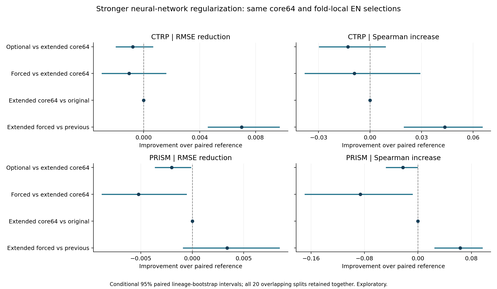
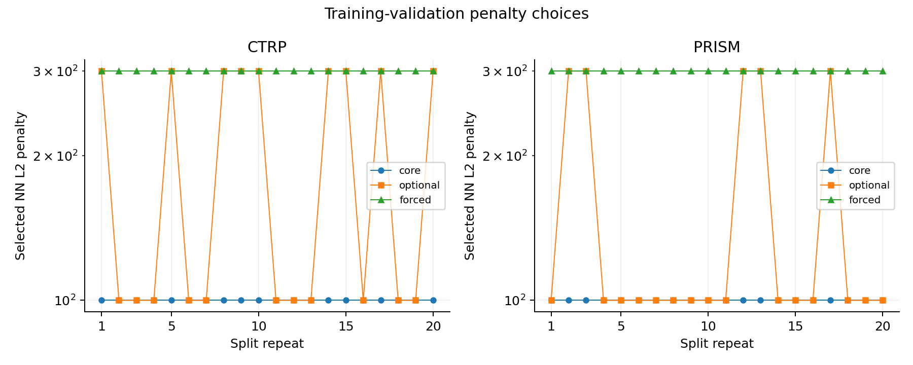

# Stronger NN regularization for Elastic Net-selected additions

The original core64 panel is mandatory. The same fold-local Elastic Net selections, outer/inner splits, three-network initialization seeds and NN architecture/solver are reused. Added L2 penalties are 300, 1,000, 3,000, 10,000 and 30,000; existing values are retained and reused exactly. No top-K gene cap is introduced.

The extended-grid core64-only control separates a general regularization benefit from the value of extra genes. The optional arm may select no additions; the forced arm selects the best nonempty setting. Both tune jointly inside the original five inner folds across all 20 seeds per assay.

## Matched-control findings

**Retain the core64 panel.** Extending the penalty grid improved the previous forced-expansion models, especially in CTRP, but did not establish lower error than the matched core64-only control. Every core-only fit selected alpha=100; every forced-expansion fit selected alpha=300. Neither end of the extended penalty grid was selected. These findings concern the tested EN/NN procedure and previously inspected cohorts.

**CTRP, optional_extended:** RMSE 0.116968 -> 0.117741 (0.66% higher error); 3/20 favorable, 11/20 ties. Paired reduction -0.000773, conditional 95% interval [-0.001951, +0.000632], which includes no difference.
Added genes: mean 126.2, range 0-839, zero-addition fits 11/20.

**CTRP, forced_extended:** RMSE 0.116968 -> 0.118001 (0.88% higher error); 9/20 favorable, 0/20 ties. Paired reduction -0.001033, conditional 95% interval [-0.002954, +0.001569], which includes no difference.
Added genes: mean 275.4, range 60-887, zero-addition fits 0/20.

**PRISM, optional_extended:** RMSE 0.138203 -> 0.140203 (1.45% higher error); 0/20 favorable, 15/20 ties. Paired reduction -0.002000, conditional 95% interval [-0.003578, -0.000170], which favors worse performance.
Added genes: mean 69.5, range 0-477, zero-addition fits 15/20.

**PRISM, forced_extended:** RMSE 0.138203 -> 0.143416 (3.77% higher error); 2/20 favorable, 0/20 ties. Paired reduction -0.005213, conditional 95% interval [-0.008743, -0.000604], which favors worse performance.
Added genes: mean 228.7, range 56-570, zero-addition fits 0/20.

## Improvement over the previous forced expansion

| Assay | Previous forced NN RMSE | Extended-grid forced NN RMSE | Error reduction | Favorable repeats /20 | Conditional 95% RMSE-reduction interval |
|---|---:|---:|---:|---:|---:|
| CTRP | 0.124985 | 0.118001 | 5.59% | 20 | [+0.004619, +0.009671] |
| PRISM | 0.146790 | 0.143416 | 2.30% | 11 | [-0.000868, +0.008436] |

For PRISM, 1,000 was already present in the original grid: alpha=300 fills the prior 100-to-1,000 gap. No fit selected a penalty above 300. Positive reductions favor the extended grid. These secondary comparisons do not demonstrate an added-gene gain over the core64 control.

## Across lineages

**CTRP, forced additions:** equal-lineage RMSE 0.110514 -> 0.109591; conditional reduction interval [-0.001766, +0.004001]. Mean RMSE improves in 9/23 lineages. These secondary intervals include no difference.

**PRISM, forced additions:** equal-lineage RMSE 0.108525 -> 0.113456; conditional reduction interval [-0.011234, +0.000466]. Mean RMSE improves in 9/20 lineages. These secondary intervals include no difference.

## Held-out performance

| Assay | NN procedure | RMSE | Spearman | R2 | Equal-lineage RMSE |
|---|---|---:|---:|---:|---:|
| CTRP | Original core64 NN | 0.116968 | 0.4618 | 0.2094 | 0.110514 |
| CTRP | Core64 NN: extended penalties | 0.116968 | 0.4618 | 0.2094 | 0.110514 |
| CTRP | Previous optional additions NN | 0.117716 | 0.4543 | 0.1992 | 0.111275 |
| CTRP | Optional additions NN: extended penalties | 0.117741 | 0.4488 | 0.1982 | 0.110402 |
| CTRP | Previous forced additions NN | 0.124985 | 0.4092 | 0.0959 | 0.115963 |
| CTRP | Forced additions NN: extended penalties | 0.118001 | 0.4526 | 0.1951 | 0.109591 |
| CTRP | Core64 TabPFN | 0.115890 | 0.4734 | 0.2231 | 0.108696 |
| CTRP | Training mean | 0.132083 | undefined | -0.0062 | 0.120777 |
| PRISM | Original core64 NN | 0.138203 | 0.3616 | 0.0569 | 0.108525 |
| PRISM | Core64 NN: extended penalties | 0.138203 | 0.3616 | 0.0569 | 0.108525 |
| PRISM | Previous optional additions NN | 0.138203 | 0.3616 | 0.0569 | 0.108525 |
| PRISM | Optional additions NN: extended penalties | 0.140203 | 0.3392 | 0.0286 | 0.110104 |
| PRISM | Previous forced additions NN | 0.146790 | 0.2121 | -0.0786 | 0.120853 |
| PRISM | Forced additions NN: extended penalties | 0.143416 | 0.2754 | -0.0180 | 0.113456 |
| PRISM | Core64 TabPFN | 0.136291 | 0.3872 | 0.0818 | 0.105641 |
| PRISM | Training mean | 0.144030 | undefined | -0.0286 | 0.119545 |

All scores are means across the 20 saved holdouts; CTRP and PRISM endpoints remain separate.

## Selected genes and numerical diagnostics

Full choices are in `selected_parameters.tsv`. Training-only gene selection frequencies are in `gene_selection_stability.tsv`, separately for optional and forced arms. They are not NN feature importance, causal effects, individually validated contributions or independent replications. The selected gene set can vary between splits.

Prediction standard deviations and mean network-weight norms are saved with selected parameters, so nearly constant highly regularized predictors can be recognized. Grid-boundary counts are in `grid_boundary_audit.json`.

## Validation and scope

- Every old candidate is mapped by exact selector/width/penalty and reused unchanged. Only new penalties are fit. Sources are hash-verified against the completed previous benchmark. Source EN masks remain specific to each inner-training/outer-training subset; no consensus list is used.
- NN centering/scaling uses current training only. Gene selection, penalty and width are jointly tuned by equal-mean five-fold RMSE. Core-only and forced choices use the corresponding subsets of the same validation grid.
- Audits recompute every inner RMSE/argmin, verify reused predictions/member predictions, all outer feature sets, scaler parameters, identity exclusion, lineage coverage, seed triplets, unit weights, member predictions and training objectives. Preflight independently checks native stronger-penalty MLP fits and exact old candidate reproduction.
- New fits abort on ConvergenceWarning. SciPy L-BFGS option deprecation warnings are counted separately; they do not change optimization. No penalty is added after examining these results.
- Whole-lineage paired bootstrap preserves all models/repeats together. Intervals are conditional on fitted models, exclude retraining uncertainty and are not multiplicity-adjusted. Repeated holdouts overlap; these are not independent biological replications.
- The expanded grid was motivated by prior results on these cohorts. This remains exploratory internal validation, despite fold-local selection/tuning. A final consensus panel and each individual gene contribution need separate validation. Patient prediction and unseen-lineage transfer are outside scope.
- These EN selectors use linear conditional associations and can miss genes that act only through nonlinear interactions. The benchmark does not exhaust all gene subsets or neural-network architectures.
- The original core64 panel and retained registry remain unchanged. Culture covariates and lineage prediction features are excluded. Protein-coding RNA coverage, finite grid and original endpoint provenance limitations remain.

Penalty units follow the training objective in the pinned implementation: the L2 term is divided by the training sample count. See [scikit-learn MLPRegressor documentation](https://scikit-learn.org/stable/modules/generated/sklearn.neural_network.MLPRegressor.html).
