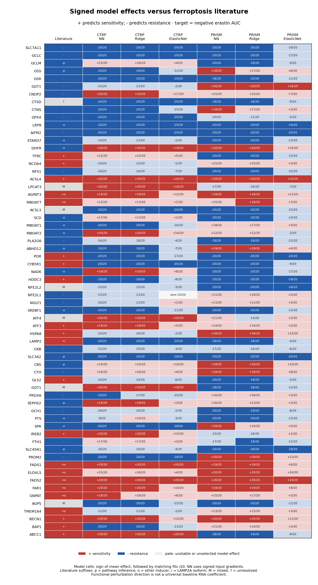

# Signed effects of all 64 genes versus ferroptosis literature

**Positive means higher predicted erastin sensitivity; negative means higher predicted resistance.** Both response targets are negative AUC. This audit covers all 120 retained models, with 20 saved fits per family and assay. Neural-network (NN) signs are ensemble input gradients, not raw first-layer weights. Ridge and Elastic Net use signed standardized-expression coefficients.

The supplied review and primary studies were checked in a targeted literature audit through 2026-11-02. This is not an exhaustive systematic review. Literature roles describe increased functional activity in the cited contexts; they do not prescribe the sign of a basal mRNA coefficient across cancer lineages.

## Findings

The NN directions for **SLC7A11 (-), AIFM2/FSP1 (-), GCLC (-), and ACSL4 (+)** agree with the cited defense/sensitization mechanisms in both assays, with matching signs in all 20 fits. **LRP8 (-)** also agrees with its published resistance role, particularly established in GPX4-inhibitor studies. [2](https://pmc.ncbi.nlm.nih.gov/articles/PMC4054777/), [11](https://www.nature.com/articles/s41586-019-1707-0), [3](https://pmc.ncbi.nlm.nih.gov/articles/PMC7839835/), [19](https://pmc.ncbi.nlm.nih.gov/articles/PMC5610546/), [10](https://pmc.ncbi.nlm.nih.gov/articles/PMC9469796/).

**GPX4 is negative in every CTRP NN fit but is unstable in PRISM (10 positive and 10 negative fits).** Its small negative PRISM mean must not be reported as reliable cross-assay agreement. The established protective GPX4 mechanism does not make an unstable model effect informative. [9](https://pmc.ncbi.nlm.nih.gov/articles/PMC4076414/).

**POR and CYB5R1 have stable negative NN effects in both assays**, opposite to the pro-ferroptotic oxidoreductase function reported in primary work. This is a useful model-association discrepancy, not evidence that the proteins protect cells experimentally. [28](https://doi.org/10.1016/j.molcel.2020.11.024).

**ABCC1 is a special case:** GSH export can sensitize cells to ferroptosis despite resistance to some other drugs. The CTRP positive sign agrees; the PRISM negative sign opposes this role, although its held-out importance is weak. [50](https://pmc.ncbi.nlm.nih.gov/articles/PMC6424331/).

**GGT1 and PROM2** have resistance evidence, but positive PRISM NN slopes. **HDDC3/MESH1** has erastin-sensitization evidence but negative NN slopes. **LAMP2** is negative in both NNs whereas the relevant primary evidence concerns sensitizing LAMP2A-mediated GPX4 degradation; total-gene RNA is an isoform mismatch. [5](https://pmc.ncbi.nlm.nih.gov/articles/PMC8897698/), [42](https://pmc.ncbi.nlm.nih.gov/articles/PMC8316835/), [30](https://www.nature.com/articles/s42255-020-0181-1), [36](https://pmc.ncbi.nlm.nih.gov/articles/PMC6386716/).

**DHFR and BH4-pathway annotations need an inducer qualifier.** The cited study shows BH4 dependence and DHFR-mediated protection under GPX4 inhibition, not the same requirement under cystine deprivation. Positive DHFR coefficients oppose that general defense expectation but are not a clean falsification of an erastin-specific prediction. [13](https://pmc.ncbi.nlm.nih.gov/articles/PMC8299533/).

**CTSD source correction:** the supplied review says cathepsin D in its albumin-catabolism paragraph and cites reference 59. That primary study explicitly identifies cathepsin B (CTSB), not CTSD, as the principal albumin-degrading protease. The earlier panel annotation inherited this source discrepancy. CTSD remains in the retained 64-gene model, but this citation cannot establish its protective direction. A newer CTSD glycosylation study in colorectal metastasis is context/PTM-specific and does not settle the pan-cancer erastin RNA sign. [1](https://doi.org/10.1038/s41580-024-00703-5), [6](https://pmc.ncbi.nlm.nih.gov/articles/PMC9762237/), [8](https://pmc.ncbi.nlm.nih.gov/articles/PMC11831497/).

**Context-dependent cases are not forced into a binary agreement score:** LPCAT3, ACSL3, AGPS, NFE2L2, ATF4 and GOT1. The cited contexts include different lipid substrates, KRAS-mutant lung cancer, antioxidant efflux programs and starvation versus pancreatic-cancer metabolism. [23](https://www.nature.com/articles/s41467-022-31963-4), [22](https://pmc.ncbi.nlm.nih.gov/articles/PMC7483868/), [50](https://pmc.ncbi.nlm.nih.gov/articles/PMC6424331/), [34](https://www.nature.com/articles/s41419-021-04018-7), [35](https://pmc.ncbi.nlm.nih.gov/articles/PMC13135238/), [15](https://pmc.ncbi.nlm.nih.gov/articles/PMC4506736/), [16](https://pmc.ncbi.nlm.nih.gov/articles/PMC8357841/).

**GSR has recent functional corroboration:** the September 2026 study reports sensitization after GSR knockout, including erastin. It also analyzes CTRP expression-response associations; that observational concordance reuses public cell-line data and must not be counted as independent validation of our prediction results. [51](https://pmc.ncbi.nlm.nih.gov/articles/PMC13531920/).

## Complete gene-by-gene comparison

Literature **S** = functional sensitizer; **R** = functional resistance/protection; **M** = documented mixed roles; **?** = unresolved. These codes are not a universal expression biomarker label. Model cells show sign and matching fits out of 20. A stable descriptive label requires at least 18/20 nonzero same-direction fits and, for NN, at least 90% of held-out appearances with matching gradient sign. Pale cells in the figure fail this rule. No significance test is implied.

| Gene | Literature role | CTRP NN | PRISM NN | Evidence context / caveat | Sources |
|---|---|---|---|---|---|
| SLC7A11 | R (-) | - (20/20) | - (20/20) | functional; erastin_cystine. Cystine import supports GSH defense; target abundance is not target inhibition or dependency. | [2](https://pmc.ncbi.nlm.nih.gov/articles/PMC4054777/) |
| GCLC | R (-) | - (20/20) | - (20/20) | functional; cystine. GCLC protects during cystine starvation through GSH and noncanonical peptide metabolism. | [3](https://pmc.ncbi.nlm.nih.gov/articles/PMC7839835/) |
| GCLM | R (-) | + (15/20) unstable | - (20/20) | pathway; pathway. GCL modifier subunit; protective pathway expectation, not a universal independent RNA-expression effect. | [3](https://pmc.ncbi.nlm.nih.gov/articles/PMC7839835/), [41](https://pmc.ncbi.nlm.nih.gov/articles/PMC6952604/) |
| GSS | R (-) | - (19/20) | + (18/20) | pathway; pathway. GSH synthesis supports defense; cystine-starved cells can also use GSH-independent protective pathways. | [1](https://doi.org/10.1038/s41580-024-00703-5), [3](https://pmc.ncbi.nlm.nih.gov/articles/PMC7839835/) |
| GSR | R (-) | - (20/20) | - (18/20) | functional; erastin_and_other. GSH recycling protects and knockout sensitizes tested cells. The 2026 paper also analyzes CTRP expression-response data; that observational result is not independent of our public-data benchmark. | [51](https://pmc.ncbi.nlm.nih.gov/articles/PMC13531920/) |
| GGT1 | R (-) | - (15/20) unstable | + (20/20) | functional; cystine. Extracellular GSH salvage protects glioblastoma cells; depends on substrate availability and cell density. | [5](https://pmc.ncbi.nlm.nih.gov/articles/PMC8897698/) |
| CNDP2 | R (-) | + (20/20) | + (15/20) unstable | functional; cystine. Cysteinylglycine hydrolysis supplies cysteine; protection requires extracellular GSH-derived substrates. | [4](https://pubmed.ncbi.nlm.nih.gov/34324979/) |
| CTSD | ? | - (20/20) | - (18/20) | source_conflict; unresolved. Review names cathepsin D, but reference 59 identifies cathepsin B/CTSB. Newer CTSD glycosylation/CRC work does not establish a pan-cancer erastin mRNA direction. | [1](https://doi.org/10.1038/s41580-024-00703-5), [6](https://pmc.ncbi.nlm.nih.gov/articles/PMC9762237/), [8](https://pmc.ncbi.nlm.nih.gov/articles/PMC11831497/) |
| CTNS | R (-) | - (20/20) | + (18/20) | functional; cystine. Lysosomal cystine export supports cysteine supply and adaptive ATF4; albumin and lysosomal context matter. | [6](https://pmc.ncbi.nlm.nih.gov/articles/PMC9762237/), [7](https://pmc.ncbi.nlm.nih.gov/articles/PMC10529971/) |
| GPX4 | R (-) | - (20/20) | - (10/20) unstable | functional; erastin_and_other. Lipid peroxide detoxification protects; mRNA does not measure selenoprotein abundance or enzymatic activity. | [9](https://pmc.ncbi.nlm.nih.gov/articles/PMC4076414/) |
| LRP8 | R (-) | - (20/20) | - (20/20) | functional; other_inducer. Selenium uptake maintains GPX4 translation; strongest direct evidence involves GPX4-inhibitor sensitivity. | [10](https://pmc.ncbi.nlm.nih.gov/articles/PMC9469796/) |
| AIFM2 | R (-) | - (20/20) | - (20/20) | functional; general_ferroptosis. FSP1-dependent antioxidant defense protects; localization and reductase activity matter. | [11](https://www.nature.com/articles/s41586-019-1707-0) |
| STARD7 | R (-) | - (14/20) unstable | - (20/20) | functional; other_inducer. Cytosolic STARD7 supplies plasma-membrane CoQ; total RNA does not resolve processing or localization. | [12](https://pmc.ncbi.nlm.nih.gov/articles/PMC9928583/) |
| DHFR | R (-) | + (20/20) | + (20/20) | functional; other_inducer. BH4 recycling protects against GPX4 inhibition. That study did not establish the same requirement under cystine depletion. | [13](https://pmc.ncbi.nlm.nih.gov/articles/PMC8299533/) |
| TFRC | S (+) | + (12/20) unstable | - (20/20) | functional; cystine_and_starvation. Transferrin-mediated iron uptake supports death in tested starvation models; trafficking and iron loading matter. | [15](https://pmc.ncbi.nlm.nih.gov/articles/PMC4506736/) |
| NCOA4 | S (+) | - (14/20) unstable | + (15/20) unstable | functional; erastin. Ferritinophagy sensitizes to erastin in HeLa; the same study did not find equivalent RSL3 dependence. | [17](https://pubmed.ncbi.nlm.nih.gov/33245979/) |
| NFS1 | R (-) | - (16/20) unstable | - (20/20) | functional; cystine. Iron-sulfur maintenance protects from ferroptosis; dependence varies with oxygen tension. | [18](https://pmc.ncbi.nlm.nih.gov/articles/PMC5808442/) |
| ACSL4 | S (+) | + (20/20) | + (20/20) | functional; general_ferroptosis. PUFA activation usually sensitizes; requirement depends on cell context and available lipids. | [19](https://pmc.ncbi.nlm.nih.gov/articles/PMC5610546/) |
| LPCAT3 | M | + (20/20) | - (17/20) unstable | mixed; mixed. Usually sensitizes through PUFA remodeling; protective palmitate remodeling is reported in KRAS-mutant lung cancer. | [1](https://doi.org/10.1038/s41580-024-00703-5), [23](https://www.nature.com/articles/s41467-022-31963-4) |
| AGPAT3 | S (+) | + (19/20) | + (19/20) | functional; other_inducer. PUFA phospholipid synthesis promotes GPX4-inhibitor sensitivity in tested cancer models. | [21](https://pmc.ncbi.nlm.nih.gov/articles/PMC8051864/) |
| MBOAT7 | S (+) | + (13/20) unstable | + (15/20) unstable | functional; other_inducer. MMD-dependent PUFA-PI remodeling promotes ferroptosis; overexpression alone need not be sufficient. | [20](https://pmc.ncbi.nlm.nih.gov/articles/PMC10591818/) |
| ACSL3 | M | - (20/20) | - (20/20) | mixed; mixed. Usually supports MUFA-mediated resistance, with a pro-ferroptotic exception in KRAS-mutant lung cancer. | [1](https://doi.org/10.1038/s41580-024-00703-5), [23](https://www.nature.com/articles/s41467-022-31963-4) |
| SCD | R (-) | + (17/20) unstable | - (20/20) | functional; other_inducer. MUFA production supports resistance through lipid remodeling; substrate and signaling context matter. | [25](https://pmc.ncbi.nlm.nih.gov/articles/PMC7733797/) |
| MBOAT1 | R (-) | - (20/20) | + (18/20) unstable | functional; other_inducer. MUFA remodeling protects, notably in estrogen-receptor-positive breast cancer. | [24](https://pmc.ncbi.nlm.nih.gov/articles/PMC10330611/) |
| MBOAT2 | R (-) | + (20/20) | + (12/20) unstable | functional; other_inducer. MUFA remodeling protects, notably in androgen-receptor-positive prostate cancer. | [24](https://pmc.ncbi.nlm.nih.gov/articles/PMC10330611/) |
| PLA2G6 | R (-) | - (16/20) unstable | - (19/20) | functional; general_ferroptosis. Oxidized phospholipid hydrolysis removes pro-ferroptotic lipid signals. | [26](https://pmc.ncbi.nlm.nih.gov/articles/PMC8152680/) |
| ABHD12 | R (-) | - (18/20) | + (19/20) | functional; other_inducer. Inhibition potentiates ferroptosis by altering phosphatidylserine lipid remodeling. | [27](https://pmc.ncbi.nlm.nih.gov/articles/PMC7386317/) |
| POR | S (+) | - (20/20) | - (20/20) | functional; general_ferroptosis. Electron-transfer-dependent lipid oxidation promotes ferroptosis; model RNA associations need not follow this function. | [28](https://doi.org/10.1016/j.molcel.2020.11.024) |
| CYB5R1 | S (+) | - (20/20) | - (20/20) | functional; general_ferroptosis. Oxidoreductase activity supports lipid oxidation; distinguish CYB5R1 from CYB5R3. | [28](https://doi.org/10.1016/j.molcel.2020.11.024) |
| NADK | R (-) | + (19/20) | - (20/20) | functional; other_inducer. Recent HT1080 perturbation evidence supports NADPH-dependent protection; erastin was explicitly left for future testing. | [29](https://pmc.ncbi.nlm.nih.gov/articles/PMC12730079/) |
| HDDC3 | S (+) | - (19/20) | - (20/20) | functional; erastin. MESH1 overexpression sensitizes and depletion protects tested cells against erastin; multiple substrates and stress programs may contribute. | [30](https://www.nature.com/articles/s42255-020-0181-1) |
| NFE2L2 | M | - (15/20) unstable | - (20/20) | mixed; mixed. NRF2 usually protects, but can also induce sensitizing ABCC1-mediated GSH efflux. | [32](https://pubmed.ncbi.nlm.nih.gov/26403645/), [50](https://pmc.ncbi.nlm.nih.gov/articles/PMC6424331/) |
| NFE2L1 | R (-) | - (13/20) unstable | + (11/20) unstable | functional; general_ferroptosis. NRF1 supports GPX4-dependent protection; requires post-translational maturation. | [31](https://pmc.ncbi.nlm.nih.gov/articles/PMC8931371/) |
| NGLY1 | R (-) | - (16/20) unstable | + (13/20) unstable | functional; general_ferroptosis. Deglycosylation enables NFE2L1-mediated protection; RNA is not enzyme or processed NRF1 activity. | [31](https://pmc.ncbi.nlm.nih.gov/articles/PMC8931371/) |
| SREBF1 | R (-) | - (20/20) | - (20/20) | functional; other_inducer. SREBP-driven lipogenesis commonly protects via SCD/MUFAs; transcription-factor activation is not basal RNA. | [25](https://pmc.ncbi.nlm.nih.gov/articles/PMC7733797/) |
| ATF4 | M | + (20/20) | + (11/20) unstable | mixed; mixed. Adaptive cysteine-stress programs can protect, whereas CHAC1-associated stress programs can promote ferroptosis. | [7](https://pmc.ncbi.nlm.nih.gov/articles/PMC10529971/), [34](https://www.nature.com/articles/s41419-021-04018-7), [35](https://pmc.ncbi.nlm.nih.gov/articles/PMC13135238/) |
| ATF3 | S (+) | + (18/20) | + (14/20) unstable | functional; erastin. Direct study shows SLC7A11 repression and erastin sensitization; stress-induced activation differs from basal RNA. | [33](https://pubmed.ncbi.nlm.nih.gov/31273299/) |
| HSPA8 | S (+) | - (14/20) unstable | + (18/20) | functional; erastin. HSC70 participates in chaperone-mediated GPX4 degradation; broad chaperone functions complicate expression interpretation. | [36](https://pmc.ncbi.nlm.nih.gov/articles/PMC6386716/) |
| LAMP2 | S (+) | - (20/20) | - (18/20) | isoform; erastin_isoform. Evidence concerns LAMP2A-mediated GPX4 degradation; gene-level LAMP2 RNA combines isoforms and other lysosomal functions. | [36](https://pmc.ncbi.nlm.nih.gov/articles/PMC6386716/) |
| CKB | R (-) | - (12/20) unstable | - (17/20) unstable | functional; general_ferroptosis. GPX4 phosphorylation prevents chaperone-mediated degradation; kinase activation is not inferred from RNA alone. | [37](https://pubmed.ncbi.nlm.nih.gov/37156912/) |
| SLC3A2 | R (-) | - (20/20) | - (20/20) | pathway; pathway. System xc- heavy-chain partner supports cystine import; also serves other amino-acid transporters. | [2](https://pmc.ncbi.nlm.nih.gov/articles/PMC4054777/) |
| CBS | R (-) | + (14/20) unstable | + (19/20) | pathway; erastin_cystine_pathway. Transsulfuration supplies cysteine; reported pathway protection does not establish a universal CBS-expression coefficient. | [38](https://pmc.ncbi.nlm.nih.gov/articles/PMC4716307/) |
| CTH | R (-) | + (16/20) unstable | + (19/20) | functional; erastin_cystine. Transsulfuration can bypass cystine-import blockade; methionine availability and pathway flux matter. | [38](https://pmc.ncbi.nlm.nih.gov/articles/PMC4716307/) |
| GLS2 | S (+) | - (14/20) unstable | - (20/20) | functional; cystine_and_starvation. Glutaminolysis promotes ferroptosis in tested starvation models; GLS2 and GLS1 are distinct genes. | [15](https://pmc.ncbi.nlm.nih.gov/articles/PMC4506736/) |
| GOT1 | M | + (20/20) | - (18/20) | mixed; mixed. Can promote starvation-associated ferroptosis; in pancreatic cancer, GOT1 loss sensitizes cells to antioxidant-pathway inhibition. | [15](https://pmc.ncbi.nlm.nih.gov/articles/PMC4506736/), [16](https://pmc.ncbi.nlm.nih.gov/articles/PMC8357841/) |
| PRDX6 | R (-) | - (19/20) | + (16/20) unstable | functional; general_ferroptosis. Selenium delivery supports GPX4 synthesis and protection; not simply a lipid peroxide expression marker. | [39](https://pmc.ncbi.nlm.nih.gov/articles/PMC11327102/) |
| SEPHS2 | R (-) | + (19/20) | + (16/20) unstable | pathway; pathway. Selenoprotein synthesis machinery supports GPX4; gene-specific pan-cancer erastin-expression direction not established here. | [39](https://pmc.ncbi.nlm.nih.gov/articles/PMC11327102/) |
| GCH1 | R (-) | - (16/20) unstable | - (20/20) | functional; erastin_and_other. BH4 defense protects against GPX4 inhibition; erastin protection is demonstrated in selected colorectal cancer models. | [13](https://pmc.ncbi.nlm.nih.gov/articles/PMC8299533/), [14](https://pmc.ncbi.nlm.nih.gov/articles/PMC8866854/) |
| PTS | R (-) | - (8/20) unstable | - (20/20) | functional; other_inducer. BH4 synthesis supports GPX4-inhibitor resistance in tested cells; not a universal erastin dependency. | [13](https://pmc.ncbi.nlm.nih.gov/articles/PMC8299533/) |
| SPR | R (-) | - (20/20) | + (18/20) | functional; other_inducer. BH4 synthesis supports GPX4-inhibitor resistance in tested cells; inducer and salvage routes matter. | [13](https://pmc.ncbi.nlm.nih.gov/articles/PMC8299533/) |
| IREB2 | S (+) | + (20/20) | - (15/20) unstable | functional; erastin. IRP2 knockdown protected cells in the original erastin screen; iron-regulatory activity is central. | [40](https://pmc.ncbi.nlm.nih.gov/articles/PMC3367386/) |
| FTH1 | R (-) | + (17/20) unstable | - (17/20) unstable | functional; erastin_and_other. Ferritin heavy chain limits labile iron; loading and ferritinophagy can differ from RNA abundance. | [32](https://pubmed.ncbi.nlm.nih.gov/26403645/), [41](https://pmc.ncbi.nlm.nih.gov/articles/PMC6952604/) |
| SLC40A1 | R (-) | - (16/20) unstable | - (20/20) | pathway; erastin_cystine_pathway. Ferroportin-mediated iron export is protective; BACH1 pathway evidence is not a universal independent expression effect. | [41](https://pmc.ncbi.nlm.nih.gov/articles/PMC6952604/) |
| PROM2 | R (-) | - (20/20) | + (20/20) | functional; erastin_and_other. Iron export through ferritin-containing vesicles protects tested epithelial/breast cells. | [42](https://pmc.ncbi.nlm.nih.gov/articles/PMC8316835/) |
| FADS1 | S (+) | + (20/20) | + (19/20) | functional; other_inducer. PUFA synthesis sensitizes tested gastric and breast cancer cells; extracellular lipids affect flux. | [43](https://pubmed.ncbi.nlm.nih.gov/33288688/), [44](https://pubmed.ncbi.nlm.nih.gov/38926633/) |
| ELOVL5 | S (+) | + (15/20) unstable | + (20/20) | functional; other_inducer. PUFA elongation supports sensitization in gastric cancer; not a universal erastin-expression biomarker. | [43](https://pubmed.ncbi.nlm.nih.gov/33288688/) |
| FADS2 | S (+) | + (20/20) | + (20/20) | functional; other_inducer. PUFA synthesis promotes ferroptosis in tested breast cancer models; substrate context matters. | [44](https://pubmed.ncbi.nlm.nih.gov/38926633/) |
| FAR1 | S (+) | + (20/20) | + (19/20) | functional; other_inducer. Ether-lipid substrate production promotes ferroptosis in tested cancer settings. | [21](https://pmc.ncbi.nlm.nih.gov/articles/PMC8051864/), [45](https://pmc.ncbi.nlm.nih.gov/articles/PMC8329287/) |
| GNPAT | S (+) | + (18/20) | + (15/20) unstable | functional; other_inducer. Ether-lipid synthesis supports ferroptosis; direct GNPAT perturbation evidence also involves cigarette-smoke extract. | [21](https://pmc.ncbi.nlm.nih.gov/articles/PMC8051864/), [46](https://pubmed.ncbi.nlm.nih.gov/38041059/) |
| AGPS | M | - (20/20) | - (20/20) | mixed; mixed. Loss can protect some cancer cells, while AGPS inhibition sensitizes other human cells and ether lipids protect worms. | [21](https://pmc.ncbi.nlm.nih.gov/articles/PMC8051864/), [22](https://pmc.ncbi.nlm.nih.gov/articles/PMC7483868/) |
| TMEM164 | S (+) | - (12/20) unstable | + (13/20) unstable | functional; other_inducer. Pro-ferroptotic arachidonoyl ether phospholipids support GPX4-inhibitor sensitivity. | [47](https://pubmed.ncbi.nlm.nih.gov/36782012/) |
| BECN1 | S (+) | + (20/20) | + (20/20) | functional; erastin. Phosphorylated BECN1 inhibits system xc-; basal RNA does not report phosphorylation or complex formation. | [48](https://pmc.ncbi.nlm.nih.gov/articles/PMC6081251/) |
| BAP1 | S (+) | - (20/20) | + (11/20) unstable | functional; erastin. Wild-type BAP1 represses SLC7A11 and promotes ferroptosis; mutation and catalytic function matter. | [49](https://pubmed.ncbi.nlm.nih.gov/30202049/) |
| ABCC1 | S (+) | + (20/20) | - (18/20) | functional; erastin_and_other. MRP1 GSH export sensitizes to ferroptosis despite resistance to some other drugs. | [50](https://pmc.ncbi.nlm.nih.gov/articles/PMC6424331/) |



## All-model summaries

The complete spreadsheet-style table includes the signed standardized effect, repeat support, direction stability, held-out predictive rank/importance and literature assessment for **ridge, Elastic Net and NN** in both assays. Elastic Net zeros are retained as unselected rather than assigned a positive or negative biological direction.

[Concise NN gene-by-gene comparison (CSV)](nn_gene_direction_comparison.csv) · [All 64 genes, six model/assay combinations (CSV)](all64_gene_signs_and_literature.csv) · [TSV summary](summary.tsv) · [Detailed model effects](model_directions_long.tsv) · [Per-lineage slopes](per_lineage_signed_effects.tsv)

NN mean signs are the same across assays for 41/64 genes; 21/64 have the same sign and meet the descriptive stability rule in both. The number of stable NN signs is 41 in CTRP and 45 in PRISM. These counts concern model stability, not biological validation.

## Interpretation

A multivariate coefficient or gradient holds the other inputs fixed. Correlated expression, lineage/state proxies, regulatory feedback, selenium availability, medium composition and protein regulation can separate this conditional association from a perturbation phenotype. Do not flip or constrain coefficients solely to match a literature label. A sign can also be stable while replacement importance is zero or negative; the tables retain both measures to avoid confusing output influence with useful prediction.

The model uses baseline gene-level RNA. Papers often manipulate enzyme activity, protein localization, isoforms, phosphorylation, glycosylation, knockout or inducer dose. No new model was trained and no gene was removed or substituted. In particular, the CTSD/CTSB finding is an evidence annotation issue and does not retroactively change the fitted panel.

The same overlapping holdouts and repeatedly inspected cohorts are reused. This is an exploratory interpretation audit, not an independent test of gene function. Literature disagreement is descriptive and does not refute a primary study. Literature curation was not blinded to earlier model results, so concordance counts are not a formal validation statistic.

## Verification and reproduction

All 120 model hashes and source/input/split hashes were verified against the retained registry and original importance records. Saved coefficients and NN gradients were independently reconstructed on the exact held-out cells; per-repeat and per-lineage results reproduced. Exact Elastic Net zero/sign counts were checked. All 64 genes have explicit literature roles or an uncertainty label and at least one cited source. See [validation](validation.json), [protocol](protocol.json), [evidence](candidate_gene_evidence.json) and [references](references.json).

```bash
python outputs/erastin_gene_direction_literature/curate_evidence.py
PYTHONPATH="$PWD/work/bulkformer/packages" OPENBLAS_NUM_THREADS=1 OMP_NUM_THREADS=1 \
MPLCONFIGDIR="$PWD/work/bulkformer/matplotlib_cache" PYTHONDONTWRITEBYTECODE=1 \
/home/sji/miniforge3/envs/deeplearning/bin/python outputs/erastin_gene_direction_literature/audit_directions.py
```

## References

1. [Dixon and Olzmann, The cell biology of ferroptosis (2024)](https://doi.org/10.1038/s41580-024-00703-5)
2. [Pharmacological inhibition of cystine-glutamate exchange induces endoplasmic reticulum stress and ferroptosis](https://pmc.ncbi.nlm.nih.gov/articles/PMC4054777/)
3. [Non-canonical glutamate-cysteine ligase activity protects against ferroptosis](https://pmc.ncbi.nlm.nih.gov/articles/PMC7839835/)
4. [Carnosine dipeptidase II protects cells under cysteine insufficiency by hydrolyzing glutathione-related peptides](https://pubmed.ncbi.nlm.nih.gov/34324979/)
5. [Expression of gamma-glutamyltransferase 1 in glioblastoma cells confers resistance to cystine deprivation-induced ferroptosis](https://pmc.ncbi.nlm.nih.gov/articles/PMC8897698/)
6. [Ferroptosis inhibition by lysosome-dependent catabolism of extracellular protein](https://pmc.ncbi.nlm.nih.gov/articles/PMC9762237/)
7. [Lysosomal cystine governs ferroptosis sensitivity in cancer via cysteine stress response](https://pmc.ncbi.nlm.nih.gov/articles/PMC10529971/)
8. [N-glycosylation Modification of CTSD Affects Liver Metastases in Colorectal Cancer](https://pmc.ncbi.nlm.nih.gov/articles/PMC11831497/)
9. [Regulation of ferroptotic cancer cell death by GPX4](https://pmc.ncbi.nlm.nih.gov/articles/PMC4076414/)
10. [Ribosome stalling during selenoprotein translation exposes a ferroptosis vulnerability](https://pmc.ncbi.nlm.nih.gov/articles/PMC9469796/)
11. [FSP1 is a glutathione-independent ferroptosis suppressor](https://www.nature.com/articles/s41586-019-1707-0)
12. [Mitochondria regulate intracellular coenzyme Q transport and ferroptotic resistance via STARD7](https://pmc.ncbi.nlm.nih.gov/articles/PMC9928583/)
13. [Metabolic determinants of cancer cell sensitivity to canonical ferroptosis inducers](https://pmc.ncbi.nlm.nih.gov/articles/PMC8299533/)
14. [Blockade of GCH1/BH4 axis activates ferritinophagy to mitigate colorectal cancer resistance to erastin-induced ferroptosis](https://pmc.ncbi.nlm.nih.gov/articles/PMC8866854/)
15. [Glutaminolysis and transferrin regulate ferroptosis](https://pmc.ncbi.nlm.nih.gov/articles/PMC4506736/)
16. [GOT1 inhibition promotes pancreatic cancer cell death by ferroptosis](https://pmc.ncbi.nlm.nih.gov/articles/PMC8357841/)
17. [NCOA4-mediated ferritinophagy promotes ferroptosis induced by erastin, but not by RSL3 in HeLa cells](https://pubmed.ncbi.nlm.nih.gov/33245979/)
18. [NFS1 undergoes positive selection in lung tumours and protects cells from ferroptosis](https://pmc.ncbi.nlm.nih.gov/articles/PMC5808442/)
19. [ACSL4 dictates ferroptosis sensitivity by shaping cellular lipid composition](https://pmc.ncbi.nlm.nih.gov/articles/PMC5610546/)
20. [MMD collaborates with ACSL4 and MBOAT7 to promote polyunsaturated phosphatidylinositol remodeling and susceptibility to ferroptosis](https://pmc.ncbi.nlm.nih.gov/articles/PMC10591818/)
21. [Plasticity of ether lipids promotes ferroptosis susceptibility and evasion](https://pmc.ncbi.nlm.nih.gov/articles/PMC8051864/)
22. [Dietary lipids induce ferroptosis in Caenorhabditis elegans and human cancer cells](https://pmc.ncbi.nlm.nih.gov/articles/PMC7483868/)
23. [Targeting de novo lipogenesis and the Lands cycle induces ferroptosis in KRAS-mutant lung cancer](https://www.nature.com/articles/s41467-022-31963-4)
24. [Ferroptosis surveillance independent of GPX4 and differentially regulated by sex hormones](https://pmc.ncbi.nlm.nih.gov/articles/PMC10330611/)
25. [Oncogenic activation of PI3K-AKT-mTOR signaling suppresses ferroptosis via SREBP-mediated lipogenesis](https://pmc.ncbi.nlm.nih.gov/articles/PMC7733797/)
26. [Phospholipase iPLA2beta averts ferroptosis by eliminating a redox lipid death signal](https://pmc.ncbi.nlm.nih.gov/articles/PMC8152680/)
27. [Blockade of the lysophosphatidylserine lipase ABHD12 potentiates ferroptosis in cancer cells](https://pmc.ncbi.nlm.nih.gov/articles/PMC7386317/)
28. [Membrane damage during ferroptosis is caused by oxidation of phospholipids catalyzed by the oxidoreductases POR and CYB5R1](https://doi.org/10.1016/j.molcel.2020.11.024)
29. [NADK governs ferroptosis susceptibility by orchestrating NADPH homeostasis](https://pmc.ncbi.nlm.nih.gov/articles/PMC12730079/)
30. [MESH1 is a cytosolic NADPH phosphatase that regulates ferroptosis](https://www.nature.com/articles/s42255-020-0181-1)
31. [Ferroptosis regulation by the NGLY1/NFE2L1 pathway](https://pmc.ncbi.nlm.nih.gov/articles/PMC8931371/)
32. [Activation of the p62-Keap1-NRF2 pathway protects against ferroptosis in hepatocellular carcinoma cells](https://pubmed.ncbi.nlm.nih.gov/26403645/)
33. [ATF3 promotes erastin-induced ferroptosis by suppressing system Xc-](https://pubmed.ncbi.nlm.nih.gov/31273299/)
34. [The regulation of ferroptosis by MESH1 through the activation of the integrative stress response](https://www.nature.com/articles/s41419-021-04018-7)
35. [EIF2alpha-ATF4-CHAC1 signalling links ER stress to ferroptosis in human aortic smooth muscle cells](https://pmc.ncbi.nlm.nih.gov/articles/PMC13135238/)
36. [Chaperone-mediated autophagy is involved in the execution of ferroptosis](https://pmc.ncbi.nlm.nih.gov/articles/PMC6386716/)
37. [Creatine kinase B suppresses ferroptosis by phosphorylating GPX4 through a moonlighting function](https://pubmed.ncbi.nlm.nih.gov/37156912/)
38. [Loss of cysteinyl-tRNA synthetase induces the transsulfuration pathway and inhibits ferroptosis induced by cystine deprivation](https://pmc.ncbi.nlm.nih.gov/articles/PMC4716307/)
39. [PRDX6 augments selenium utilization to limit iron toxicity and ferroptosis](https://pmc.ncbi.nlm.nih.gov/articles/PMC11327102/)
40. [Ferroptosis: an iron-dependent form of non-apoptotic cell death](https://pmc.ncbi.nlm.nih.gov/articles/PMC3367386/)
41. [Ferroptosis is controlled by coordinated transcriptional regulation of glutathione and labile iron metabolism by BACH1](https://pmc.ncbi.nlm.nih.gov/articles/PMC6952604/)
42. [Prominin2 drives ferroptosis resistance by stimulating multivesicular body/exosome-mediated iron export](https://pmc.ncbi.nlm.nih.gov/articles/PMC8316835/)
43. [Polyunsaturated fatty acid biosynthesis pathway determines ferroptosis sensitivity in gastric cancer](https://pubmed.ncbi.nlm.nih.gov/33288688/)
44. [FADS1/2 control lipid metabolism and ferroptosis susceptibility in triple-negative breast cancer](https://pubmed.ncbi.nlm.nih.gov/38926633/)
45. [Peroxisome-driven ether-linked phospholipid biosynthesis is essential for ferroptosis](https://pmc.ncbi.nlm.nih.gov/articles/PMC8329287/)
46. [CSE triggers ferroptosis via SIRT4-mediated GNPAT deacetylation in the pathogenesis of COPD](https://pubmed.ncbi.nlm.nih.gov/38041059/)
47. [TMEM164 is an acyltransferase that forms ferroptotic C20:4 ether phospholipids](https://pubmed.ncbi.nlm.nih.gov/36782012/)
48. [AMPK-mediated BECN1 phosphorylation promotes ferroptosis by directly blocking system Xc- activity](https://pmc.ncbi.nlm.nih.gov/articles/PMC6081251/)
49. [BAP1 links metabolic regulation of ferroptosis to tumour suppression](https://pubmed.ncbi.nlm.nih.gov/30202049/)
50. [A genome-wide haploid genetic screen identifies regulators of glutathione abundance and ferroptosis sensitivity](https://pmc.ncbi.nlm.nih.gov/articles/PMC6424331/)
51. [Glutathione reductase deficiency potentiates the immunogenicity of ferroptosis and cuproptosis via amplified ROS accumulation and cGAS-STING activation](https://pmc.ncbi.nlm.nih.gov/articles/PMC13531920/)
