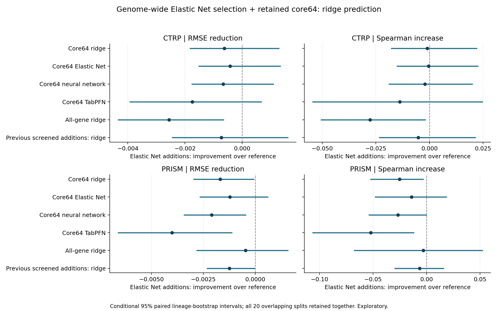
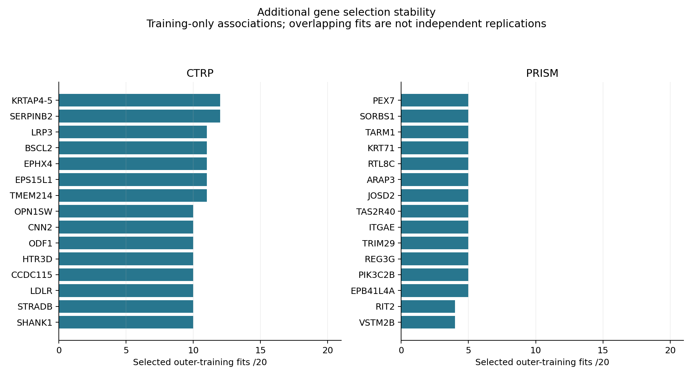

# Genome-wide Elastic Net additions to the retained 64-gene panel

Elastic Net selects outside genes jointly after adjusting for the core64 and training lineage. Ridge then fits the mandatory core64 plus selected additions. All 19,112 outside protein-coding genes are considered before current-training constants/aliases are excluded. There is no preliminary response-correlation shortlist. This experiment evaluates a gene-selection procedure, not a direct genome-wide Elastic Net predictor.

## Findings

**Retain the original core64 panel. This Elastic Net selection procedure did not establish improved pooled accuracy in either assay.** Selected genes remain discovery associations; the experiment does not demonstrate that any individual added gene improves prediction.

**CTRP:** mean RMSE 0.117005 -> 0.117629; 0.53% higher error. 6/20 favorable repeats; 8/20 ties. Paired RMSE reduction -0.000624, conditional 95% interval [-0.001815, +0.001282], which includes no difference.
Added genes: mean 328.9, median 75.0, range 0-943; core-only fallback 8/20 fits.

Equal-lineage RMSE: 0.110655 -> 0.109836; paired reduction interval [-0.000860, +0.002817]. Mean RMSE is lower in 13/23 lineages. These secondary results do not establish broad improvement.

**PRISM:** mean RMSE 0.138611 -> 0.140301; 1.22% higher error. 0/20 favorable repeats; 15/20 ties. Paired RMSE reduction -0.001689, conditional 95% interval [-0.002958, -0.000080], which favors worse performance.
Added genes: mean 88.4, median 0.0, range 0-522; core-only fallback 15/20 fits.

Equal-lineage RMSE: 0.109207 -> 0.110569; paired reduction interval [-0.003140, +0.000252]. Mean RMSE is lower in 8/20 lineages. These secondary results do not establish broad improvement.

## Held-out performance

| Assay | Model | RMSE | Spearman | R2 | Equal-lineage RMSE |
|---|---|---:|---:|---:|---:|
| CTRP | Core64 ridge | 0.117005 | 0.4606 | 0.2087 | 0.110655 |
| CTRP | Core64 Elastic Net | 0.117205 | 0.4600 | 0.2062 | 0.111193 |
| CTRP | Core64 neural network | 0.116968 | 0.4618 | 0.2094 | 0.110514 |
| CTRP | Core64 TabPFN | 0.115890 | 0.4734 | 0.2231 | 0.108696 |
| CTRP | All-gene ridge | 0.115069 | 0.4873 | 0.2344 | 0.106612 |
| CTRP | Previous screened additions: ridge | 0.116902 | 0.4648 | 0.2097 | 0.110463 |
| CTRP | Core64 + Elastic Net additions: ridge | 0.117629 | 0.4596 | 0.2002 | 0.109836 |
| CTRP | Training mean | 0.132083 | undefined | -0.0062 | 0.120777 |
| PRISM | Core64 ridge | 0.138611 | 0.3601 | 0.0514 | 0.109207 |
| PRISM | Core64 Elastic Net | 0.139082 | 0.3491 | 0.0450 | 0.109586 |
| PRISM | Core64 neural network | 0.138203 | 0.3616 | 0.0569 | 0.108525 |
| PRISM | Core64 TabPFN | 0.136291 | 0.3872 | 0.0818 | 0.105641 |
| PRISM | All-gene ridge | 0.139832 | 0.3381 | 0.0352 | 0.109160 |
| PRISM | Previous screened additions: ridge | 0.139058 | 0.3415 | 0.0448 | 0.109332 |
| PRISM | Core64 + Elastic Net additions: ridge | 0.140301 | 0.3350 | 0.0273 | 0.110569 |
| PRISM | Training mean | 0.144030 | undefined | -0.0286 | 0.119545 |

Scores are means across the saved 20 holdouts. CTRP and PRISM endpoints remain separate.

## Additional genes

The following examples rank by selection frequency, then mean absolute selector coefficient. Coefficients and sign consistency are conditional on selection; these are not causal importance or independent replications. The assays share cell lines.

### CTRP

| Gene | Entrez | Selected fits /20 | Selector sign agreement | Ridge sign agreement |
|---|---|---:|---:|---:|
| KRTAP4-5 | 85289 | 12 | 100% | 100% |
| SERPINB2 | 5055 | 12 | 100% | 83% |
| LRP3 | 4037 | 11 | 100% | 100% |
| BSCL2 | 26580 | 11 | 100% | 100% |
| EPHX4 | 253152 | 11 | 100% | 100% |
| EPS15L1 | 58513 | 11 | 100% | 100% |
| TMEM214 | 54867 | 11 | 100% | 100% |
| OPN1SW | 611 | 10 | 100% | 100% |
| CNN2 | 1265 | 10 | 100% | 100% |
| ODF1 | 4956 | 10 | 100% | 100% |
| HTR3D | 200909 | 10 | 100% | 100% |
| CCDC115 | 84317 | 10 | 100% | 100% |
| LDLR | 3949 | 10 | 100% | 100% |
| STRADB | 55437 | 10 | 100% | 100% |
| SHANK1 | 50944 | 10 | 100% | 100% |

### PRISM

| Gene | Entrez | Selected fits /20 | Selector sign agreement | Ridge sign agreement |
|---|---|---:|---:|---:|
| PEX7 | 5191 | 5 | 100% | 100% |
| SORBS1 | 10580 | 5 | 100% | 100% |
| TARM1 | 441864 | 5 | 100% | 100% |
| KRT71 | 112802 | 5 | 100% | 100% |
| RTL8C | 8933 | 5 | 100% | 100% |
| ARAP3 | 64411 | 5 | 100% | 100% |
| JOSD2 | 126119 | 5 | 100% | 100% |
| TAS2R40 | 259286 | 5 | 100% | 100% |
| ITGAE | 3682 | 5 | 100% | 100% |
| TRIM29 | 23650 | 5 | 100% | 100% |
| REG3G | 130120 | 5 | 100% | 100% |
| PIK3C2B | 5287 | 5 | 100% | 100% |
| EPB41L4A | 64097 | 5 | 100% | 100% |
| RIT2 | 6014 | 4 | 100% | 100% |
| VSTM2B | 342865 | 4 | 100% | 100% |

Full tables: `gene_selection_stability.tsv`, `cross_assay_candidate_genes.tsv`, `selected_parameters.tsv`, `lineage_paired_effects.tsv`, and `paired_comparisons.tsv`.

## Validation and interpretation

- Same cohorts, response values, identity groups, 20 outer holdouts and five inner folds as the retained benchmark; all evaluated lineages appear in both outer train/test. Cervix exclusion and singleton inner-training handling are unchanged.
- All centering, scaling, core/lineage adjustment, alpha maxima and multigene feature selection are recomputed inside each current training fold. Selector L1 ratio, alpha fraction and ridge penalty are selected by mean five-fold inner RMSE. A zero-addition candidate family prevents forced expansion.
- Every feature is considered by the multivariate objective. Working sets only accelerate coordinate descent; complete genome-wide KKT checks prevent permanent exclusion by a preliminary screen. Native full-genome solver comparisons, dual certificates, augmented-Lasso equivalence and independent ridge checks passed.
- Saved outer predictions, all inner RMSEs/choices, all outer selector KKT conditions, core retention, training scalers, recorded inner solver certificates, selected-fold replay and source hashes are audited. The solver table distinguishes independently recomputed outer certificates from recorded inner certificates.
- Some restricted solves require the prespecified tighter-tolerance retry. Recovered warnings and refinement counts are recorded in `validation.json`; every accepted final solution passes its declared global KKT/dual-gap limits.
- Whole-lineage paired bootstrap resamples lineages while keeping models/repeats together. Intervals are conditional on fitted models, do not include retraining and are not multiplicity-adjusted. Twenty overlapping repeats are not 20 independent experiments.
- These previously inspected cohorts support exploratory discovery, not untouched confirmatory accuracy. Reported scores belong to the fold-specific selection procedure; a final consensus panel needs separate validation. No individual gene is proven to add predictive value merely because it is often selected.
- Selection can still miss nonlinear interaction-only effects. The finite penalty grid, RNA-only scope and original harmonized CTRP endpoint provenance limitations remain. The original core64 and retained-model registry are unchanged.
- Read `grid_boundary_audit.json` for selected-grid limits. The frozen grid is not expanded after seeing test results.

Methods: [scikit-learn Elastic Net path](https://scikit-learn.org/stable/modules/generated/sklearn.linear_model.enet_path.html); [Ambroise and McLachlan on gene-selection bias](https://pmc.ncbi.nlm.nih.gov/articles/PMC124442/).
