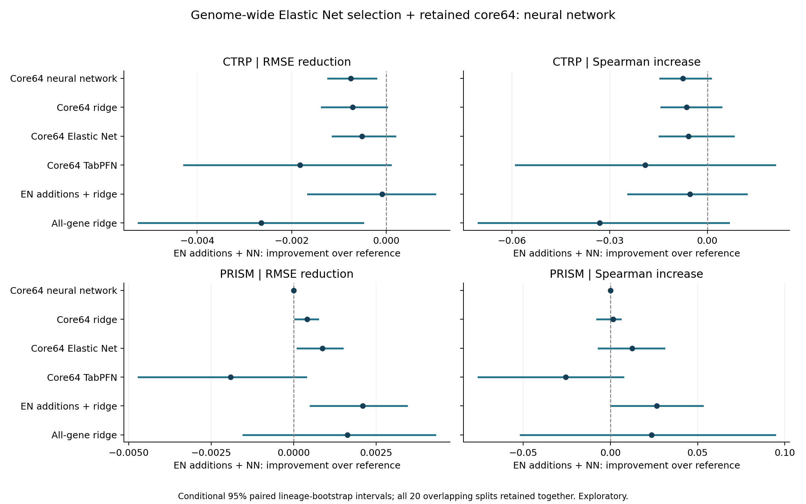
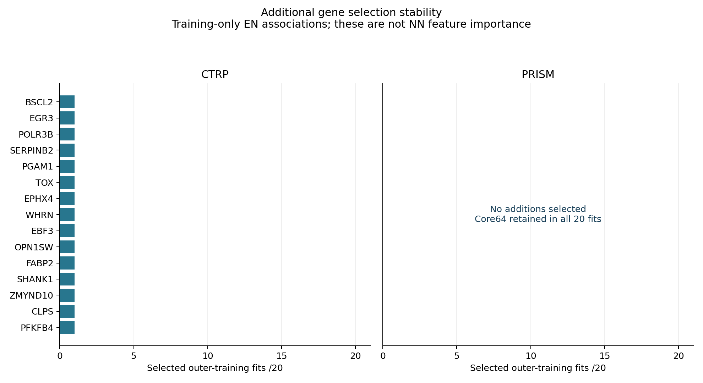

# Elastic Net-selected additions with the neural network

The original 64 RNA features are mandatory. Neural-network validation jointly chooses among the same 20 genome-wide Elastic Net selection settings plus the core-only fallback, and the original assay-specific NN hyperparameters. Three-member ensembles, initialization seeds, scaling and optimization are unchanged. All EN-selected genes are used without a top-K cap.

## Findings

**Keep the retained core64 panel. NN tuning selected zero additions in 39/40 fits. The sole selected expansion worsened its held-out result; forcing expanded panels also worsened average performance in both assays.** These findings apply to the tested grids and previously inspected cohorts.

**CTRP:** mean RMSE 0.116968 -> 0.117716, 0.64% higher error. 0/20 favorable repeats; 19/20 ties. Paired RMSE reduction -0.000749, conditional 95% interval [-0.001232, -0.000213], which favors worse performance.
Added genes: mean 2.5, median 0.0, range 0-51; zero additions 19/20. Mean error is lower in 5/23 lineages.

**PRISM:** mean RMSE 0.138203 -> 0.138203, unchanged error. 0/20 favorable repeats; 20/20 ties. Paired RMSE reduction +0.000000, conditional 95% interval [+0.000000, +0.000000], which includes no difference.
Added genes: mean 0.0, median 0.0, range 0-0; zero additions 20/20. Mean error is lower in 0/20 lineages.

## Forced-addition diagnostic

This secondary diagnostic was registered after early training-validation choices favored zero additions, before reviewing the new NN held-out scores. It selects the best nonempty EN/NN setting from the same saved inner results, then refits only on outer training. The original primary procedure stays unchanged.

| Assay | Core64 NN RMSE | Forced expansion RMSE | Error increase | Favorable repeats /20 | Conditional 95% RMSE-reduction interval |
|---|---:|---:|---:|---:|---:|
| CTRP | 0.116968 | 0.124985 | 6.85% | 1 | [-0.011683, -0.004321] |
| PRISM | 0.138203 | 0.146790 | 6.21% | 1 | [-0.011720, -0.004970] |

Positive RMSE reductions favor additions. [Diagnostic report and registration details](forced_additions/REVIEW.md).

## Held-out performance

| Assay | Model | RMSE | Spearman | R2 | Equal-lineage RMSE |
|---|---|---:|---:|---:|---:|
| CTRP | Core64 neural network | 0.116968 | 0.4618 | 0.2094 | 0.110514 |
| CTRP | Core64 ridge | 0.117005 | 0.4606 | 0.2087 | 0.110655 |
| CTRP | Core64 Elastic Net | 0.117205 | 0.4600 | 0.2062 | 0.111193 |
| CTRP | Core64 TabPFN | 0.115890 | 0.4734 | 0.2231 | 0.108696 |
| CTRP | EN additions + ridge | 0.117629 | 0.4596 | 0.2002 | 0.109836 |
| CTRP | All-gene ridge | 0.115069 | 0.4873 | 0.2344 | 0.106612 |
| CTRP | EN additions + neural network | 0.117716 | 0.4543 | 0.1992 | 0.111275 |
| CTRP | Training mean | 0.132083 | undefined | -0.0062 | 0.120777 |
| PRISM | Core64 neural network | 0.138203 | 0.3616 | 0.0569 | 0.108525 |
| PRISM | Core64 ridge | 0.138611 | 0.3601 | 0.0514 | 0.109207 |
| PRISM | Core64 Elastic Net | 0.139082 | 0.3491 | 0.0450 | 0.109586 |
| PRISM | Core64 TabPFN | 0.136291 | 0.3872 | 0.0818 | 0.105641 |
| PRISM | EN additions + ridge | 0.140301 | 0.3350 | 0.0273 | 0.110569 |
| PRISM | All-gene ridge | 0.139832 | 0.3381 | 0.0352 | 0.109160 |
| PRISM | EN additions + neural network | 0.138203 | 0.3616 | 0.0569 | 0.108525 |
| PRISM | Training mean | 0.144030 | undefined | -0.0286 | 0.119545 |

Scores are means across the same 20 saved holdouts. The assays/endpoints remain separate.

## Additional genes

Selection counts use all 20 training sets, including core-only fits. EN coefficient summaries are conditional on selection and are not neural-network feature importance, causal effects or independent replications. Ties are ordered by mean absolute selector coefficient. A 100% sign agreement from a single selection is automatic and provides no replication evidence.

### CTRP

| Gene | Entrez | Selected fits /20 | Selector sign agreement |
|---|---|---:|---:|
| BSCL2 | 26580 | 1 | 100% |
| EGR3 | 1960 | 1 | 100% |
| POLR3B | 55703 | 1 | 100% |
| SERPINB2 | 5055 | 1 | 100% |
| PGAM1 | 5223 | 1 | 100% |
| TOX | 9760 | 1 | 100% |
| EPHX4 | 253152 | 1 | 100% |
| WHRN | 25861 | 1 | 100% |
| EBF3 | 253738 | 1 | 100% |
| OPN1SW | 611 | 1 | 100% |
| FABP2 | 2169 | 1 | 100% |
| SHANK1 | 50944 | 1 | 100% |
| ZMYND10 | 51364 | 1 | 100% |
| CLPS | 1208 | 1 | 100% |
| PFKFB4 | 5210 | 1 | 100% |

### PRISM

No outside genes were selected in any of the 20 primary outer fits.

Full tables are in `gene_selection_stability.tsv`, `selected_parameters.tsv`, `paired_comparisons.tsv` and `lineage_paired_effects.tsv`.

## Validation and interpretation

- Gene-selection paths are reused from the hash-verified prior EN experiment. Every inner path used only its own inner-training rows; outer refits used only outer training. Preflight replays all 20 selectors in first/last inner folds and the outer training set of repeat 1 for each assay (120 exact gene-set checks). NN tuning does not reuse ridge-selected settings.
- Data, 20 outer holdouts, five inner assignments, identity groups and three-member NN seeds are unchanged. All evaluated lineages occur in both outer train/test; the prior Cervix exclusion and singleton inner-training handling remain. RNA-only, unweighted, no culture predictors.
- Selector and NN hyperparameters are jointly chosen by equal-mean five-fold RMSE. The zero-addition grid comes first. All NN centering/scaling uses current training only. Cached baseline inner predictions and zero-addition outer fits reproduce the original core64 models.
- Each checkpoint records inner ensemble member predictions. Audits recompute ensemble means, every candidate-fold RMSE and selection choice, saved feature lists, scaler parameters, all outer member predictions and training objectives. Source hashes, unit weights and initialization seeds are verified.
- New fits abort on ConvergenceWarning. SciPy L-BFGS option deprecation warnings are counted separately; they do not change the fits. Read `validation.json` for the final audit and warning counts.
- Whole-lineage paired bootstrap preserves all overlapping repeats and all models together. Its intervals are conditional on these fitted models, omit retraining uncertainty and are not multiplicity-adjusted. The 20 overlapping seeds are not independent experiments.
- These cohorts have informed prior model choices: results remain exploratory despite nested selection controls. Reported accuracy belongs to the fold-specific selection/tuning procedure. A consolidated gene panel, each individual gene contribution, patient transfer and unseen-lineage generalization require separate validation.
- Original measured protein-coding RNA scope, harmonized CTRP endpoint provenance and finite NN/EN grid limitations remain. Retained core64 models/registry are unchanged. Grid limits are recorded in `grid_boundary_audit.json` without post-test expansion.

CTRP selected the strongest tested NN L2 penalty (100) in all 20 primary fits. Stronger regularization is outside this benchmark; these negative results do not exclude improvement under a different prespecified grid.

The starting project snapshot was pushed to GitHub as [7aa826d](https://github.com/jiyunmaths/erastin-rnaseq-prediction/commit/7aa826d7ace8702d777fafc8240f5b34dd4744b2) before this experiment began.
