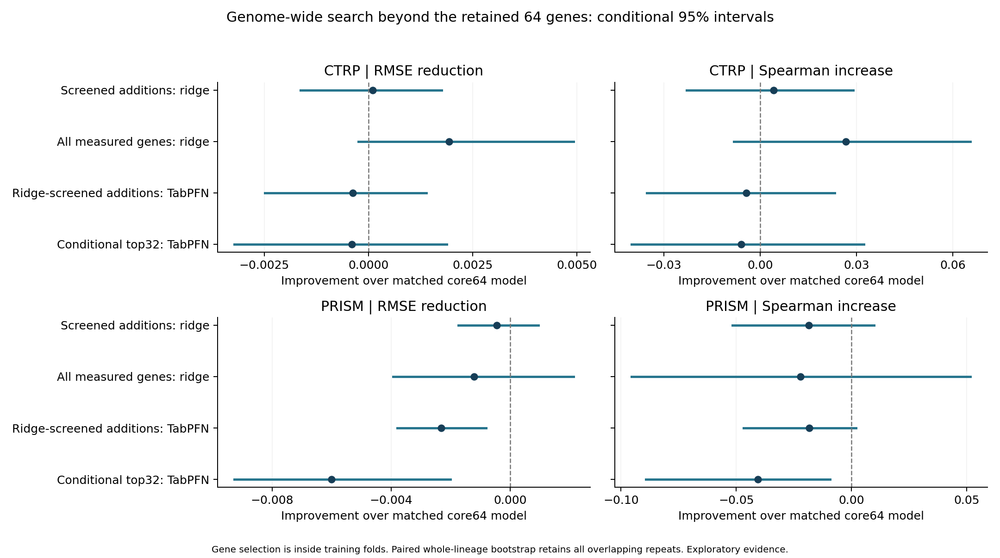
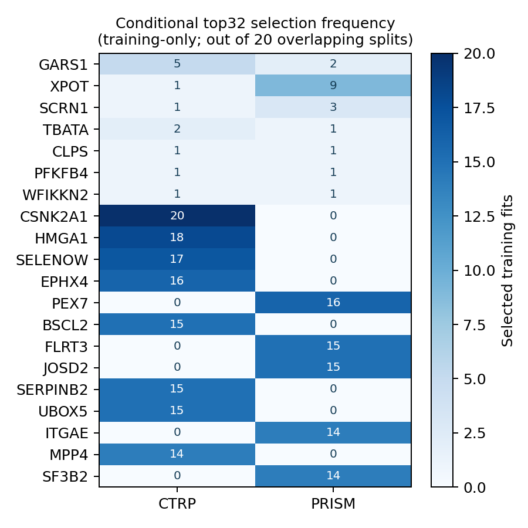

# Genome-wide RNA search beyond the retained core64 panel

The user referred to a 60-gene panel; this experiment retains the existing 64-gene panel unchanged. Search covers 19,176 unique measured protein-coding features, including 19,112 candidates outside the core. Seventeen duplicated Entrez IDs were resolved using approved release HGNC symbols. Noncoding transcripts and unmeasured DNA loci are outside this dataset.

## Findings

**Keep the core64 panel. This search did not establish a compact expansion that improves held-out accuracy.** Full-transcriptome ridge has a modest CTRP point improvement whose conditional interval includes zero, without improvement in PRISM. TabPFN additions do not improve CTRP and worsen PRISM. These results concern the tested screening procedures, not every possible gene combination.

**CTRP**

- Screened additions: ridge: 0.09% lower mean RMSE; 9/20 favorable repeats, 1/20 ties. Conditional interval includes no difference.
- All measured genes: ridge: 1.65% lower mean RMSE; 16/20 favorable repeats, 0/20 ties. Conditional interval includes no difference.
- Ridge-screened additions: TabPFN: 0.32% higher mean RMSE; 9/20 favorable repeats, 1/20 ties. Conditional interval includes no difference.
- Conditional top32: TabPFN: 0.35% higher mean RMSE; 9/20 favorable repeats, 0/20 ties. Conditional interval includes no difference.

**PRISM**

- Screened additions: ridge: 0.32% higher mean RMSE; 4/20 favorable repeats, 9/20 ties. Conditional interval includes no difference.
- All measured genes: ridge: 0.88% higher mean RMSE; 7/20 favorable repeats, 0/20 ties. Conditional interval includes no difference.
- Ridge-screened additions: TabPFN: 1.70% higher mean RMSE; 2/20 favorable repeats, 9/20 ties. Conditional interval favors worse performance.
- Conditional top32: TabPFN: 4.41% higher mean RMSE; 4/20 favorable repeats, 0/20 ties. Conditional interval favors worse performance.

| Assay | Procedure | RMSE reduction over matched core64 model | Conditional 95% interval |
|---|---|---:|---:|
| CTRP | Screened additions: ridge | +0.000103 | [-0.001636, +0.001750] |
| CTRP | All measured genes: ridge | +0.001936 | [-0.000241, +0.004913] |
| CTRP | Ridge-screened additions: TabPFN | -0.000375 | [-0.002486, +0.001390] |
| CTRP | Conditional top32: TabPFN | -0.000403 | [-0.003217, +0.001872] |
| PRISM | Screened additions: ridge | -0.000447 | [-0.001738, +0.000951] |
| PRISM | All measured genes: ridge | -0.001220 | [-0.003937, +0.002124] |
| PRISM | Ridge-screened additions: TabPFN | -0.002317 | [-0.003796, -0.000804] |
| PRISM | Conditional top32: TabPFN | -0.006008 | [-0.009271, -0.002016] |

Positive reductions favor additions. These are paired whole-lineage bootstrap intervals conditional on the fitted, overlapping splits; they do not include retraining or correct for the history of model searches.

## Held-out performance

| Assay | Model | Mean genes | RMSE | Spearman | R2 | Equal-lineage RMSE |
|---|---|---:|---:|---:|---:|---:|
| CTRP | Core64 ridge | 64.0 | 0.117005 | 0.4606 | 0.2087 | 0.110655 |
| CTRP | Core64 NN | 64.0 | 0.116968 | 0.4618 | 0.2094 | 0.110514 |
| CTRP | Core64 SVR | 64.0 | 0.117984 | 0.4536 | 0.1956 | 0.111169 |
| CTRP | Core64 kernel ridge | 64.0 | 0.116862 | 0.4610 | 0.2106 | 0.110573 |
| CTRP | Core64 TabPFN | 64.0 | 0.115890 | 0.4734 | 0.2231 | 0.108696 |
| CTRP | Core64 + nested screened genes: ridge | 150.0 | 0.116902 | 0.4648 | 0.2097 | 0.110463 |
| CTRP | All 19,176 genes: ridge | 19176.0 | 0.115069 | 0.4873 | 0.2344 | 0.106612 |
| CTRP | Core64 + ridge-screened additions: TabPFN | 90.8 | 0.116265 | 0.4691 | 0.2185 | 0.109097 |
| CTRP | Core64 + conditional top32: TabPFN | 96.0 | 0.116293 | 0.4675 | 0.2175 | 0.109239 |
| CTRP | Training mean | 0.0 | 0.132083 | undefined | -0.0062 | 0.120777 |
| PRISM | Core64 ridge | 64.0 | 0.138611 | 0.3601 | 0.0514 | 0.109207 |
| PRISM | Core64 NN | 64.0 | 0.138203 | 0.3616 | 0.0569 | 0.108525 |
| PRISM | Core64 SVR | 64.0 | 0.135287 | 0.3678 | 0.0976 | 0.104080 |
| PRISM | Core64 kernel ridge | 64.0 | 0.135521 | 0.3643 | 0.0921 | 0.107395 |
| PRISM | Core64 TabPFN | 64.0 | 0.136291 | 0.3872 | 0.0818 | 0.105641 |
| PRISM | Core64 + nested screened genes: ridge | 89.6 | 0.139058 | 0.3415 | 0.0448 | 0.109332 |
| PRISM | All 19,176 genes: ridge | 19176.0 | 0.139832 | 0.3381 | 0.0352 | 0.109160 |
| PRISM | Core64 + ridge-screened additions: TabPFN | 76.8 | 0.138608 | 0.3689 | 0.0481 | 0.106580 |
| PRISM | Core64 + conditional top32: TabPFN | 96.0 | 0.142299 | 0.3465 | -0.0066 | 0.108484 |
| PRISM | Training mean | 0.0 | 0.144030 | undefined | -0.0286 | 0.119545 |

Scores are means across repeats. A compact panel can vary between training splits; the mean gene count is not a single locked final panel.

## Candidate genes

The strongest training-only conditional candidates differ between assays. Counts describe overlapping training sets and are not independent replications, causal evidence or validation of a consolidated gene panel. The assays also share many cell lines.

| Assay | Examples among the most frequently selected conditional candidates (fits /20; ties possible) |
|---|---|
| CTRP | CSNK2A1 (20/20), HMGA1 (18/20), SELENOW (17/20), EPHX4 (16/20), BSCL2 (15/20) |
| PRISM | PEX7 (16/20), FLRT3 (15/20), JOSD2 (15/20), ITGAE (14/20), SF3B2 (14/20) |

The table below puts genes selected in both assays first, then orders the remaining genes by total selection count. Mean conditional correlations are calculated only among training fits in which a gene was selected; a dash means it was never selected for that assay, not zero correlation.

| Gene | Entrez ID | CTRP fits /20 | PRISM fits /20 | CTRP mean conditional correlation | PRISM mean conditional correlation |
|---|---|---:|---:|---:|---:|
| GARS1 | 2617 | 5 | 2 | +0.160 | +0.247 |
| XPOT | 11260 | 1 | 9 | +0.146 | +0.243 |
| SCRN1 | 9805 | 1 | 3 | +0.158 | +0.237 |
| TBATA | 219793 | 2 | 1 | +0.168 | +0.228 |
| CLPS | 1208 | 1 | 1 | +0.172 | +0.245 |
| PFKFB4 | 5210 | 1 | 1 | -0.180 | +0.254 |
| WFIKKN2 | 124857 | 1 | 1 | +0.152 | +0.253 |
| CSNK2A1 | 1457 | 20 | 0 | +0.198 | - |
| HMGA1 | 3159 | 18 | 0 | +0.183 | - |
| SELENOW | 6415 | 17 | 0 | -0.183 | - |
| EPHX4 | 253152 | 16 | 0 | +0.169 | - |
| PEX7 | 5191 | 0 | 16 | - | +0.262 |
| BSCL2 | 26580 | 15 | 0 | -0.182 | - |
| FLRT3 | 23767 | 0 | 15 | - | -0.253 |
| JOSD2 | 126119 | 0 | 15 | - | -0.253 |

Full training-only selection frequencies and coefficient summaries are in `gene_selection_stability.tsv`, `cross_assay_candidate_genes.tsv`, and `genome_ridge_top_coefficients.tsv`. Dense-ridge coefficients are regularized associations, not gene-selection probabilities. TabPFN selection counts are not TabPFN feature importance.

## Leakage controls and interpretation

- The core64 is mandatory. Outside genes are searched without a pathway whitelist. Only current-training constant features are filtered; the conditional method also removes numerical aliases of the control design.
- Every inner-training fold independently computes marginal and conditional rankings. Conditional correlation adjusts both candidate and target for the core64 and training-lineage indicators using an SVD projection. Models themselves use RNA only, without lineage/culture covariates.
- Selector, 0/8/16/32/64/128 additions and 17 ridge penalties are selected by five-fold erastin RMSE. Outer-training ranks are refitted only after that choice. A separate all-gene ridge control tunes 25 penalties. Zero additions recover the saved core64 ridge.
- TabPFN uses the same fixed 3.5-Fast checkpoint, eight passes and outer seed as its saved core64 baseline. One arm uses min(ridge-selected additions,32); a second always uses training-only conditional top32. No TabPFN-based tuning of gene counts or selectors uses test data. Zero additions reuse exact baseline predictions.
- Identity groups remain disjoint and every evaluated lineage is present in train/test. Both assays reuse their original 20 outer splits and inner assignments. All cells and response values are unchanged.
- Source/mapping checks, independent screen/regression checks, a validation-only decoy control, repeated ranking checks, every inner RMSE, every ridge prediction, native context checks and all source hashes are audited. Native context reloads are performed for first/last repeats, not every archive.
- Whole-lineage paired bootstrap preserves all models and repeats together. Intervals are conditional, exploratory and not multiplicity adjusted. Prior inspection of these data cannot be undone by nesting: these are selection-leakage-controlled discovery estimates, not a wholly untouched confirmatory benchmark.
- Performance concerns the fold-specific selection procedure. Taking a final consensus list from all repetitions and claiming the same accuracy would introduce selection bias; that final fixed list needs separate validation.
- Univariate screens can miss nonlinear interaction-only genes. TabPFN additions are CPU-capped at 32 and not specifically tuned for TabPFN. Neither negative results nor predictive associations establish ferroptosis mechanisms.
- The ridge addition grid ends at 128. CTRP selects that upper limit in 12/20 fits, indicating that this search does not establish an optimal compact panel size. PRISM selects no additions in 9/20 fits. The grid is not expanded after viewing held-out results.
- Original harmonized CTRP AUC provenance and TabPFN pretraining-overlap limitations remain. Retained core panel and model registry are unchanged.

Methodological reference: [Ambroise and McLachlan, selection bias in gene extraction](https://pmc.ncbi.nlm.nih.gov/articles/PMC124442/).
