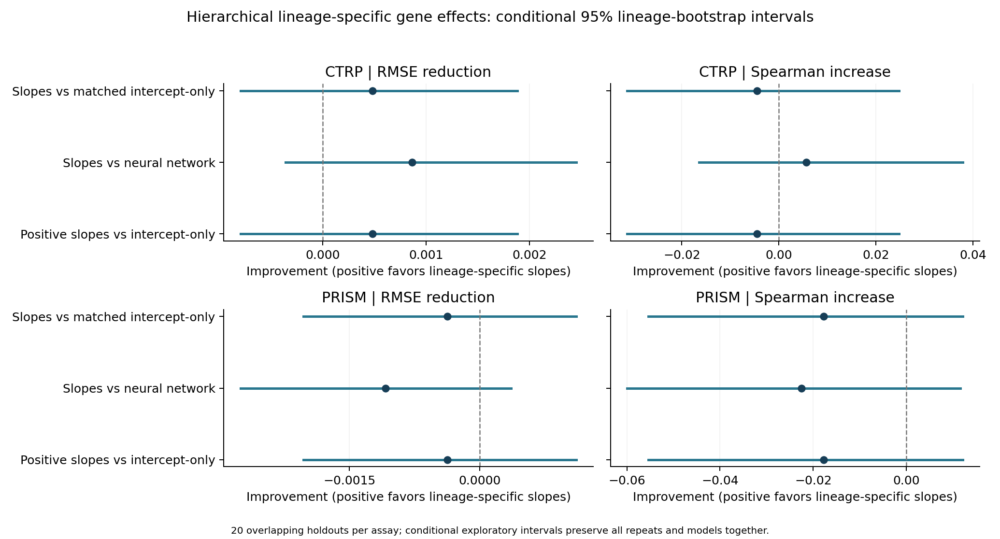

# Hierarchical lineage-specific gene slopes

This extends the previous random-intercept model by allowing all 64 gene effects to vary by lineage, with Gaussian shrinkage toward shared slopes. CTRP and PRISM remain separate. Both keep the original 20 lineage-stratified identity-group holdouts and five inner folds, with unweighted training and no culture covariates.

## Findings

**CTRP:** Positive lineage-slope variance was selected in 20/20 repeats.
- Versus Matched intercept-only model: 0.41% lower mean RMSE; 12/20 favorable, 0/20 tied; 14/23 favorable lineages. Conditional interval includes no difference.
- Versus Neural network: 0.74% lower mean RMSE; 16/20 favorable, 0/20 tied; 13/23 favorable lineages. Conditional interval includes no difference.

**PRISM:** Positive lineage-slope variance was selected in 20/20 repeats.
- Versus Matched intercept-only model: 0.27% higher mean RMSE; 12/20 favorable, 0/20 tied; 7/20 favorable lineages. Conditional interval includes no difference.
- Versus Neural network: 0.79% higher mean RMSE; 9/20 favorable, 0/20 tied; 7/20 favorable lineages. Conditional interval includes no difference.

## Held-out performance

| Assay | Model | RMSE | Spearman | R2 | Equal-lineage RMSE | Within-lineage centered Spearman |
|---|---|---:|---:|---:|---:|---:|
| CTRP | Ridge | 0.117005 | 0.4606 | 0.2087 | 0.110655 | 0.3023 |
| CTRP | Elastic Net | 0.117205 | 0.4600 | 0.2062 | 0.111193 | 0.3075 |
| CTRP | Neural network | 0.116968 | 0.4618 | 0.2094 | 0.110514 | 0.3057 |
| CTRP | RBF SVR | 0.117984 | 0.4536 | 0.1956 | 0.111169 | 0.2908 |
| CTRP | Kernel ridge | 0.116862 | 0.4610 | 0.2106 | 0.110573 | 0.3026 |
| CTRP | Previous random-intercept model | 0.116906 | 0.4676 | 0.2101 | 0.110172 | 0.2977 |
| CTRP | Lineage only | 0.123152 | 0.3813 | 0.1243 | 0.113718 | undefined |
| CTRP | Matched intercept-only model | 0.116585 | 0.4719 | 0.2144 | 0.109862 | 0.2986 |
| CTRP | Hierarchical gene slopes (fallback allowed) | 0.116103 | 0.4674 | 0.2211 | 0.109172 | 0.2971 |
| CTRP | Hierarchical gene slopes (positive variance) | 0.116103 | 0.4674 | 0.2211 | 0.109172 | 0.2971 |
| CTRP | Training mean | 0.132083 | undefined | -0.0062 | 0.120777 | undefined |
| PRISM | Ridge | 0.138611 | 0.3601 | 0.0514 | 0.109207 | 0.2720 |
| PRISM | Elastic Net | 0.139082 | 0.3491 | 0.0450 | 0.109586 | 0.2574 |
| PRISM | Neural network | 0.138203 | 0.3616 | 0.0569 | 0.108525 | 0.2721 |
| PRISM | RBF SVR | 0.135287 | 0.3678 | 0.0976 | 0.104080 | 0.3158 |
| PRISM | Kernel ridge | 0.135521 | 0.3643 | 0.0921 | 0.107395 | 0.3157 |
| PRISM | Previous random-intercept model | 0.139000 | 0.3560 | 0.0462 | 0.109479 | 0.2737 |
| PRISM | Lineage only | 0.144314 | 0.1298 | -0.0325 | 0.118451 | undefined |
| PRISM | Matched intercept-only model | 0.138915 | 0.3568 | 0.0473 | 0.109438 | 0.2734 |
| PRISM | Hierarchical gene slopes (fallback allowed) | 0.139288 | 0.3391 | 0.0389 | 0.110124 | 0.2553 |
| PRISM | Hierarchical gene slopes (positive variance) | 0.139288 | 0.3391 | 0.0389 | 0.110124 | 0.2553 |
| PRISM | Training mean | 0.144030 | undefined | -0.0286 | 0.119545 | undefined |

Values are means across repeats, not predictions averaged across outer models.

## Paired RMSE differences

| Assay | Candidate | Reference | RMSE reduction | Conditional 95% interval | Favorable repeats | Tied repeats |
|---|---|---|---:|---|---:|---:|
| CTRP | Hierarchical gene slopes (fallback allowed) | Matched intercept-only model | +0.000483 | [-0.000794, +0.001885] | 12/20 | 0/20 |
| CTRP | Hierarchical gene slopes (fallback allowed) | Ridge | +0.000902 | [-0.000264, +0.002535] | 16/20 | 0/20 |
| CTRP | Hierarchical gene slopes (fallback allowed) | Neural network | +0.000865 | [-0.000361, +0.002455] | 16/20 | 0/20 |
| CTRP | Hierarchical gene slopes (positive variance) | Matched intercept-only model | +0.000483 | [-0.000794, +0.001885] | 12/20 | 0/20 |
| CTRP | Hierarchical gene slopes (positive variance) | Neural network | +0.000865 | [-0.000361, +0.002455] | 16/20 | 0/20 |
| CTRP | Hierarchical gene slopes (fallback allowed) | Previous random-intercept model | +0.000804 | [-0.000363, +0.002089] | 15/20 | 0/20 |
| CTRP | Hierarchical gene slopes (fallback allowed) | Kernel ridge | +0.000759 | [-0.000445, +0.002270] | 12/20 | 0/20 |
| CTRP | Hierarchical gene slopes (fallback allowed) | RBF SVR | +0.001881 | [-0.000074, +0.003929] | 16/20 | 0/20 |
| CTRP | Matched intercept-only model | Previous random-intercept model | +0.000321 | [+0.000080, +0.000608] | 14/20 | 0/20 |
| PRISM | Hierarchical gene slopes (fallback allowed) | Matched intercept-only model | -0.000373 | [-0.002033, +0.001116] | 12/20 | 0/20 |
| PRISM | Hierarchical gene slopes (fallback allowed) | Ridge | -0.000677 | [-0.002345, +0.000844] | 11/20 | 0/20 |
| PRISM | Hierarchical gene slopes (fallback allowed) | Neural network | -0.001085 | [-0.002756, +0.000361] | 9/20 | 0/20 |
| PRISM | Hierarchical gene slopes (positive variance) | Matched intercept-only model | -0.000373 | [-0.002033, +0.001116] | 12/20 | 0/20 |
| PRISM | Hierarchical gene slopes (positive variance) | Neural network | -0.001085 | [-0.002756, +0.000361] | 9/20 | 0/20 |
| PRISM | Hierarchical gene slopes (fallback allowed) | Previous random-intercept model | -0.000289 | [-0.001921, +0.001176] | 12/20 | 0/20 |
| PRISM | Hierarchical gene slopes (fallback allowed) | Kernel ridge | -0.003767 | [-0.007735, -0.000574] | 2/20 | 0/20 |
| PRISM | Hierarchical gene slopes (fallback allowed) | RBF SVR | -0.004002 | [-0.009287, +0.000287] | 3/20 | 0/20 |
| PRISM | Matched intercept-only model | Previous random-intercept model | +0.000084 | [-0.000042, +0.000221] | 6/20 | 17/20 |

## Model and audit details

- Shared globally standardized gene effects, partially pooled lineage offsets and partially pooled local gene-slope deviations. Local deviations act on expression centered by each lineage current-training mean; all 64 genes are included without outcome-driven selection.
- Gaussian MAP mixed model with variance/penalty ratios selected in inner CV. This is not full Bayesian posterior sampling; bootstrap intervals concern prediction differences, not posterior gene-effect probabilities.
- The matched intercept-only arm uses the same global/intercept variance-ratio grid. The older random-intercept baseline uses a different independent intercept-penalty grid and is shown separately.
- Full grid: 17 global penalties, five intercept variance weights and five local-slope variance weights (425 candidates). Matched intercept-only uses 85 candidates; positive-slope sensitivity arm uses 340. Zero slopes can be selected in the full model.
- All preprocessing and lineage centering fit only the current inner/outer training set. Singleton training lineages have zero local design and exactly zero slope deviation. Every evaluated lineage appears in outer training and testing; this is not an unseen-lineage benchmark.
- Compact fitted coefficients reproduce the dual-kernel predictions. All 850 first-inner-fold assay/candidate combinations were independently checked using explicit lineage-by-gene features and native ridge. Selected first/last-repeat outer and inner fits were independently checked again.
- Every saved baseline/new prediction, scaler, lineage center, selected candidate and inner-fold RMSE was audited. Source models and input/split hashes are unchanged. 120 new arm/repeat bundles and 280 saved baselines are included; identical selected fits are reused across arms.
- Whole-lineage paired bootstrap preserves every model and all 20 overlapping repeats. Intervals are conditional on this cohort/fits, exploratory and unadjusted for multiplicity. Repeatedly inspected splits require confirmation on new data.
- Within-lineage centered correlations remove held-out lineage means from both observations and predictions for evaluation only. They are never used to fit or tune.
- Prior CTRP AUC provenance limitation remains; outcomes and assays are unchanged. No retained model registry changes.

Detailed evidence: `summary.tsv`, `paired_comparisons.tsv`, `lineage_win_counts.tsv`, `selected_parameters.tsv`, `lineage_effect_norms.tsv`, `protocol.json` and `validation.json`.
