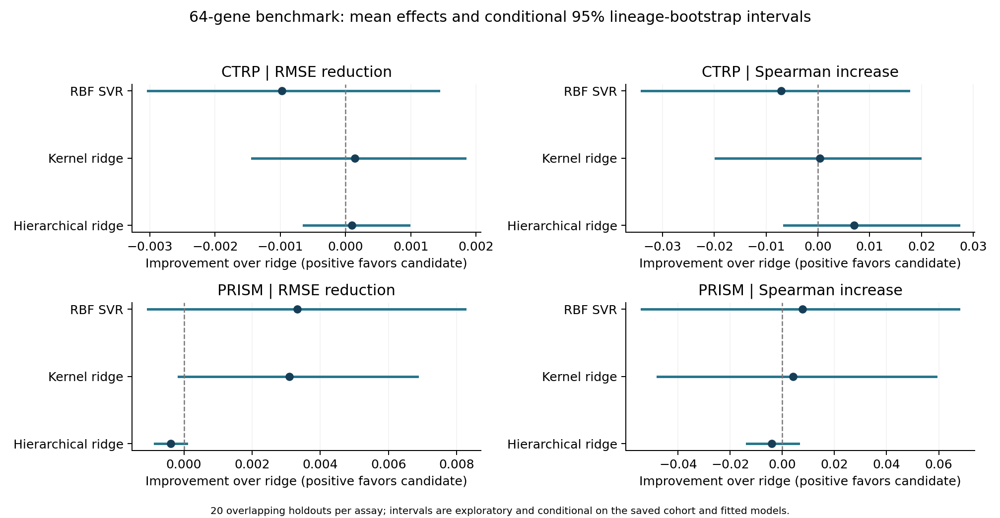

# Kernel and lineage benchmark on the 64-gene panel

Completed separate CTRP and PRISM comparisons using the exact saved 20 lineage-stratified identity-group holdouts and five inner folds. Training is unweighted; culture variables are excluded. All evaluated lineages occur in outer training and testing. No retained model or registry was replaced.

## Findings and next step

**CTRP:** Neither kernel ridge nor hierarchical ridge establishes an improvement over the retained neural network. Kernel ridge reduces mean RMSE by 0.09% (13/20 favorable repeats; 11/23 favorable lineages versus NN). Hierarchical ridge has the highest mean Spearman (0.4676), but only a 0.05% mean RMSE reduction versus NN and no positive paired interval excluding zero. SVR is worse on mean RMSE.

**PRISM:** SVR is the strongest candidate by mean RMSE: 0.135287 versus 0.138203 for the retained NN, a 2.11% reduction, favorable in 16/20 repeats and 16/20 lineages. Kernel ridge reaches 0.135521, a 1.94% reduction, favorable in 17/20 repeats and 12/20 lineages. Their paired RMSE-reduction intervals versus NN are [-0.001270, +0.007697] and [-0.000369, +0.006292], respectively; both include zero. SVR also improves mean R2 (0.0976 versus 0.0569) and evaluation-only within-lineage centered Spearman (0.3158 versus 0.2721). Hierarchical ridge worsens PRISM RMSE by 0.58% versus NN, with its paired harm interval excluding zero.

**Lineage information:** Lineage-only controls are inferior to the gene models in both assays. Adding partially pooled offsets does not consistently help. Correlations within each lineage are undefined for the lineage-only model by design. A BLAS rounding artifact of at most 1.11e-16 was removed in this control evaluation only; no fits, selected parameters or gene-model predictions changed. See `analysis_source_manifest.json`.

**Grid limits:** PRISM SVR selects the largest tested epsilon (0.2 training-target SD) in all 20 fits; its tuning optimum may extend outside this fixed grid. Kernel ridge selects the pure RBF kernel in all 20 PRISM fits. No test-informed grid expansion was performed.

**Decision:** Keep the retained registry unchanged. Carry PRISM SVR and kernel ridge forward as exploratory candidates, with CTRP ridge/NN remaining competitive. The next information-adding experiment is multi-task learning with related ferroptosis-drug responses, keeping every held-out identity group out of all drug-training tasks. A larger SVR epsilon grid could be a separately registered refinement, requiring fresh confirmation after these repeatedly inspected splits.

## Held-out performance

Values are means across repeats, not predictions averaged across fitted models. Lower RMSE and higher Spearman/R2 are better. The response scale differs between assays.

| Assay | Model | RMSE | Spearman | R2 | Equal-lineage RMSE | Within-lineage centered Spearman |
|---|---|---:|---:|---:|---:|---:|
| CTRP | Ridge | 0.117005 | 0.4606 | 0.2087 | 0.110655 | 0.3023 |
| CTRP | Elastic Net | 0.117205 | 0.4600 | 0.2062 | 0.111193 | 0.3075 |
| CTRP | Neural network | 0.116968 | 0.4618 | 0.2094 | 0.110514 | 0.3057 |
| CTRP | RBF SVR | 0.117984 | 0.4536 | 0.1956 | 0.111169 | 0.2908 |
| CTRP | Kernel ridge | 0.116862 | 0.4610 | 0.2106 | 0.110573 | 0.3026 |
| CTRP | Hierarchical ridge | 0.116906 | 0.4676 | 0.2101 | 0.110172 | 0.2977 |
| CTRP | Lineage only | 0.123152 | 0.3813 | 0.1243 | 0.113718 | undefined |
| CTRP | Training mean | 0.132083 | nan | -0.0062 | 0.120777 | undefined |
| PRISM | Ridge | 0.138611 | 0.3601 | 0.0514 | 0.109207 | 0.2720 |
| PRISM | Elastic Net | 0.139082 | 0.3491 | 0.0450 | 0.109586 | 0.2574 |
| PRISM | Neural network | 0.138203 | 0.3616 | 0.0569 | 0.108525 | 0.2721 |
| PRISM | RBF SVR | 0.135287 | 0.3678 | 0.0976 | 0.104080 | 0.3158 |
| PRISM | Kernel ridge | 0.135521 | 0.3643 | 0.0921 | 0.107395 | 0.3157 |
| PRISM | Hierarchical ridge | 0.139000 | 0.3560 | 0.0462 | 0.109479 | 0.2737 |
| PRISM | Lineage only | 0.144314 | 0.1298 | -0.0325 | 0.118451 | undefined |
| PRISM | Training mean | 0.144030 | nan | -0.0286 | 0.119545 | undefined |

## Paired RMSE comparison

Positive reduction favors the new model. Intervals resample entire lineage blocks while keeping all models and repeats paired; they are not 20-independent-cohort confidence intervals and are not multiplicity adjusted.

| Assay | Candidate | Reference | RMSE reduction | Relative reduction | Conditional 95% interval | Favorable repeats | Favorable lineages |
|---|---|---|---:|---:|---|---:|---:|
| CTRP | RBF SVR | Ridge | -0.000979 | -0.84% | [-0.003028, +0.001428] | 8/20 | 13/23 |
| CTRP | RBF SVR | Neural network | -0.001016 | -0.87% | [-0.002985, +0.001254] | 7/20 | 11/23 |
| CTRP | Kernel ridge | Ridge | +0.000143 | +0.12% | [-0.001431, +0.001829] | 13/20 | 13/23 |
| CTRP | Kernel ridge | Neural network | +0.000106 | +0.09% | [-0.001382, +0.001719] | 13/20 | 11/23 |
| CTRP | Hierarchical ridge | Ridge | +0.000098 | +0.08% | [-0.000641, +0.000970] | 14/20 | 10/23 |
| CTRP | Hierarchical ridge | Neural network | +0.000061 | +0.05% | [-0.000681, +0.000817] | 12/20 | 11/23 |
| CTRP | RBF SVR | Elastic Net | -0.000779 | -0.66% | [-0.002940, +0.001589] | 8/20 | 13/23 |
| CTRP | Kernel ridge | Elastic Net | +0.000344 | +0.29% | [-0.001237, +0.001969] | 12/20 | 15/23 |
| CTRP | Hierarchical ridge | Elastic Net | +0.000299 | +0.26% | [-0.000446, +0.001162] | 11/20 | 14/23 |
| CTRP | Hierarchical ridge | Lineage only | +0.006246 | +5.07% | [+0.001227, +0.010122] | 19/20 | 14/23 |
| CTRP | Lineage only | Training mean | +0.008931 | +6.76% | [+0.003277, +0.015043] | 20/20 | 13/23 |
| PRISM | RBF SVR | Ridge | +0.003325 | +2.40% | [-0.001052, +0.008242] | 16/20 | 15/20 |
| PRISM | RBF SVR | Neural network | +0.002916 | +2.11% | [-0.001270, +0.007697] | 16/20 | 16/20 |
| PRISM | Kernel ridge | Ridge | +0.003090 | +2.23% | [-0.000151, +0.006852] | 17/20 | 13/20 |
| PRISM | Kernel ridge | Neural network | +0.002682 | +1.94% | [-0.000369, +0.006292] | 17/20 | 12/20 |
| PRISM | Hierarchical ridge | Ridge | -0.000388 | -0.28% | [-0.000848, +0.000072] | 4/20 | 6/20 |
| PRISM | Hierarchical ridge | Neural network | -0.000797 | -0.58% | [-0.001274, -0.000318] | 5/20 | 6/20 |
| PRISM | RBF SVR | Elastic Net | +0.003795 | +2.73% | [-0.000553, +0.008691] | 17/20 | 13/20 |
| PRISM | Kernel ridge | Elastic Net | +0.003561 | +2.56% | [+0.000279, +0.007321] | 19/20 | 12/20 |
| PRISM | Hierarchical ridge | Elastic Net | +0.000083 | +0.06% | [-0.000671, +0.000737] | 12/20 | 10/20 |
| PRISM | Hierarchical ridge | Lineage only | +0.005314 | +3.68% | [+0.001971, +0.008244] | 19/20 | 16/20 |
| PRISM | Lineage only | Training mean | -0.000283 | -0.20% | [-0.001131, +0.000684] | 8/20 | 10/20 |

## Validation and interpretation

- 160 new saved outer models (including 40 lineage-only controls) and 120 unchanged retained models were audited.
- Every saved outer prediction was reproduced from its fitted model. Every new candidate/fold RMSE and selected candidate was recomputed.
- Independent references use native RBF SVR, native kernel ridge with KernelCenterer, and augmented least squares for the hierarchical model. All first-fold candidates plus selected first/last-repeat inner and outer fits were checked.
- All outer/inner splits were reproduced from the original generators; identity groups remain disjoint, including always-inner-training CTRP Ampulla.
- Lineage offsets are jointly fitted Gaussian random-intercept MAP estimates with tuned penalties; gene slopes are shared across lineages. This comparison does not test lineage-specific gene slopes or unseen lineages.
- The lineage-only model measures tissue-baseline information. Within-lineage centered correlation subtracts each held-out lineage mean from both observations and predictions for evaluation only; it is not used for fitting or tuning.
- Full fixed grids, training-only scalers, source checksums and convergence checks are recorded. Boundary choices are reported without expanding grids after inspecting test results.
- These overlapping splits have informed prior modelling choices. Improvements remain exploratory and need confirmation on new samples. The original harmonized CTRP AUC provenance limitation remains.

See `summary.tsv`, `paired_comparisons.tsv`, `lineage_win_counts.tsv`, `per_lineage_metrics.tsv`, `selected_parameters.tsv`, `grid_boundary_audit.tsv`, `protocol.json` and `validation.json` for the numerical evidence.
