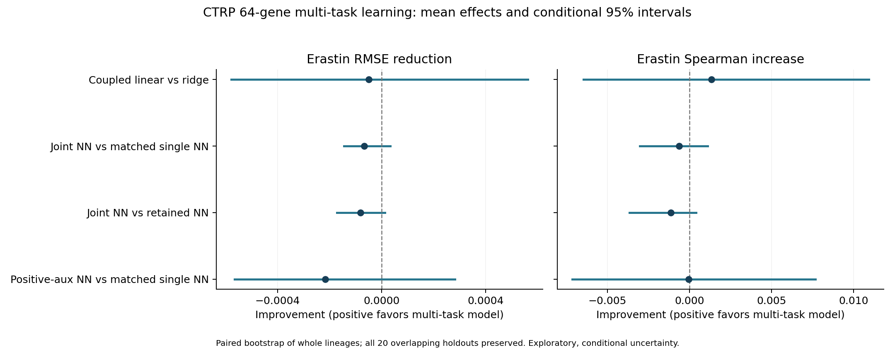

# Multi-task learning across ferroptosis inducers

Same 744 CTRP lines, 733 identity groups, 23 lineages, 64 genes, 20 saved lineage-stratified holdouts and five inner folds. All held-out identity groups are excluded from every drug-training task. No culture or lineage predictors; no new auxiliary-only cell lines.

Targets are separate negative CTRP AUCs for erastin, 1S,3R-RSL-3, ML162 and ML210. Observed label counts are 744/721/721/690. Missing labels are masked; all task means and scales use only observed training labels. Only erastin inner-validation RMSE selects settings. Inference requires RNA only.

## Findings

- **Coupled linear vs ridge:** 0.04% higher mean RMSE; favorable in 13/20 repeats, tied in 0/20. The conditional interval includes no difference.
- **Joint NN vs matched single NN:** 0.06% higher mean RMSE; favorable in 0/20 repeats, tied in 17/20. The conditional interval includes no difference.
- **Joint NN vs retained NN:** 0.07% higher mean RMSE; favorable in 6/20 repeats, tied in 0/20. The conditional interval includes no difference.
- **Positive-aux NN vs matched single NN:** 0.19% higher mean RMSE; favorable in 6/20 repeats, tied in 0/20. The conditional interval includes no difference.

The neural selector used zero auxiliary weight in 17/20 repeats. This tested configuration does not establish an erastin prediction gain from the related-drug responses. Keep the retained models unchanged; this does not rule out other multi-task formulations or additional training cohorts.

The matched neural comparison isolates the effect of adding auxiliary losses within this implementation. Comparison with the retained NN also includes the effect of tighter optimizer settings. Statistical intervals remain conditional and exploratory.

## Held-out erastin performance

| Model | RMSE | Spearman | R2 | Equal-lineage RMSE |
|---|---:|---:|---:|---:|
| Retained ridge | 0.117005 | 0.4606 | 0.2087 | 0.110655 |
| Retained Elastic Net | 0.117205 | 0.4600 | 0.2062 | 0.111193 |
| Retained neural network | 0.116968 | 0.4618 | 0.2094 | 0.110514 |
| Single-task RBF SVR | 0.117984 | 0.4536 | 0.1956 | 0.111169 |
| Single-task kernel ridge | 0.116862 | 0.4610 | 0.2106 | 0.110573 |
| Coupled multi-task linear | 0.117055 | 0.4620 | 0.2077 | 0.110634 |
| Matched single-task NN | 0.116981 | 0.4612 | 0.2092 | 0.110554 |
| Multi-task NN (zero-weight fallback allowed) | 0.117048 | 0.4606 | 0.2083 | 0.110643 |
| Multi-task NN (positive auxiliary weight) | 0.117198 | 0.4612 | 0.2064 | 0.110694 |
| Training mean | 0.132083 | undefined | -0.0062 | 0.120777 |

Values are means across holdouts, not predictions averaged across repeats.

## Paired RMSE differences

| Candidate | Reference | RMSE reduction | Relative reduction | Conditional 95% interval | Favorable repeats | Favorable lineages |
|---|---|---:|---:|---|---:|---:|
| Coupled multi-task linear | Retained ridge | -0.000050 | -0.04% | [-0.000579, +0.000562] | 13/20 | 12/23 |
| Multi-task NN (zero-weight fallback allowed) | Matched single-task NN | -0.000067 | -0.06% | [-0.000145, +0.000033] | 0/20 | 10/23 |
| Multi-task NN (zero-weight fallback allowed) | Retained neural network | -0.000081 | -0.07% | [-0.000172, +0.000012] | 6/20 | 11/23 |
| Multi-task NN (positive auxiliary weight) | Matched single-task NN | -0.000217 | -0.19% | [-0.000566, +0.000282] | 6/20 | 10/23 |
| Multi-task NN (positive auxiliary weight) | Retained neural network | -0.000231 | -0.20% | [-0.000556, +0.000219] | 6/20 | 9/23 |
| Coupled multi-task linear | Retained neural network | -0.000087 | -0.07% | [-0.000556, +0.000399] | 12/20 | 13/23 |
| Matched single-task NN | Retained neural network | -0.000013 | -0.01% | [-0.000089, +0.000059] | 8/20 | 9/23 |
| Multi-task NN (zero-weight fallback allowed) | Single-task kernel ridge | -0.000187 | -0.16% | [-0.001746, +0.001319] | 7/20 | 12/23 |
| Multi-task NN (zero-weight fallback allowed) | Single-task RBF SVR | +0.000936 | +0.79% | [-0.001287, +0.002866] | 13/20 | 11/23 |

Positive improvement favors the candidate. Whole-lineage bootstrap intervals retain all repeats together, are conditional on this cohort/fits and are not multiplicity adjusted. Overlapping repeats are not independent cohorts.

## Sharing selected by inner validation

- Neural model selected positive auxiliary weight in 3/20 outer repeats; zero weight reproduces its matched single-task control.
- Coupled linear model selected positive coupling in 20/20 repeats; zero coupling reproduces the original ridge objective.
- The positive-auxiliary neural arm always shares, providing a prespecified sensitivity analysis independent of the fallback choice.

## Model specification and validation

- Linear model: separate drug intercepts and slopes, with a penalty shrinking drug slopes toward their shared mean. No false claim that independent multi-output ridge shares information.
- Neural model: one shared tanh hidden layer (16/32 units), separate drug output heads, alpha 10/100, auxiliary weight 0/0.25/1 and three saved-seed initializations. Each observed response contributes equally within its task. Task weights and label-count normalization are explicit in protocol.json.
- The matched neural control uses the same implementation, optimizer, hidden/primary initialization and erastin objective; the retained neural network is also shown because its previous optimizer settings differ.
- All saved baseline/new predictions, scalers, selected settings and candidate/fold RMSEs were audited. Neural gradients were checked against PyTorch autograd and central differences. Coupled linear predictions were checked against independent augmented least squares; zero coupling against native ridge.
- Poisoning validation responses for every drug leaves training predictions unchanged; poisoning auxiliary training labels leaves the matched single-task control unchanged.
- Eighty new outer model bundles and 100 unchanged baseline models are included. Identical selected neural ensembles can be reused across reported arms; counts refer to saved arm/repeat bundles.
- CTRP only: none of these three auxiliary compounds occurs in the downloaded PRISM secondary-treatment metadata. Cross-assay auxiliary learning would be a separate experiment.
- These repeatedly inspected splits provide exploratory evidence, with no claim about patients or unseen lineages. The original harmonized CTRP AUC provenance limitation remains. The retained registry is unchanged.

Multi-task rationale: [Gonen and Margolin](https://academic.oup.com/bioinformatics/article/30/17/i556/200902). Distinct erastin/GPX4-inhibitor vulnerabilities support separate outputs rather than merged labels: [Lei et al.](https://pubmed.ncbi.nlm.nih.gov/38552003/).
