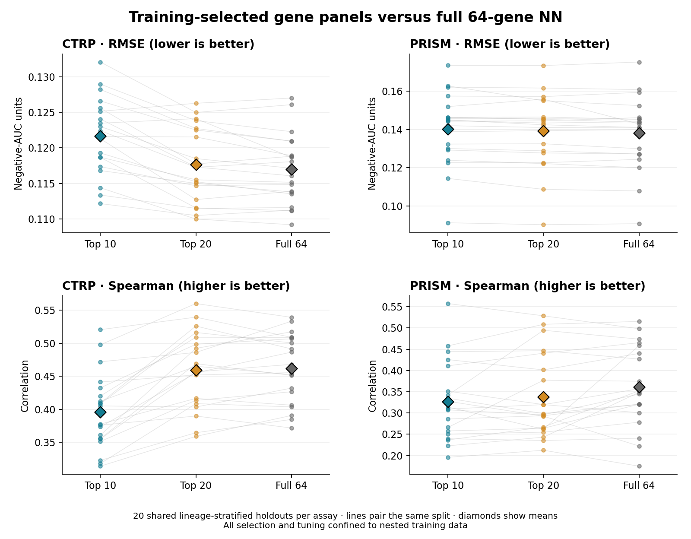
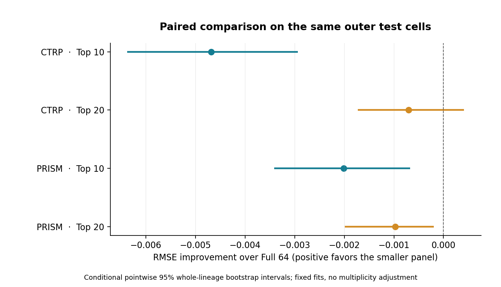

# Nested top-10, top-20 and full-64 neural-network comparison

The two reduced panels are selected **within training data**, separately for CTRP and PRISM. Each procedure is evaluated on all 20 original lineage-stratified 80/20 outer splits. The full64 comparator is the exact retained three-network ensemble for each split. Unweighted RNA-only fitting, identity groups, original NN tuning grids, seed triplets and scaling rules are preserved.

## Performance

RMSE is in original negative-AUC units; smaller is better. Correlations are against negative AUC, so larger is better. Means describe 20 overlapping holdouts, not 20 independent cohorts.

| Assay | Panel | Mean RMSE | Spearman | R2 | Equal-lineage RMSE |
|---|---|---:|---:|---:|---:|
| CTRP | top10 | 0.121652 | 0.3961 | 0.1447 | 0.114124 |
| CTRP | top20 | 0.117673 | 0.4590 | 0.1995 | 0.111186 |
| CTRP | full64 | 0.116968 | 0.4618 | 0.2094 | 0.110514 |
| PRISM | top10 | 0.140214 | 0.3268 | 0.0285 | 0.111479 |
| PRISM | top20 | 0.139178 | 0.3377 | 0.0435 | 0.110461 |
| PRISM | full64 | 0.138203 | 0.3616 | 0.0569 | 0.108525 |

Positive improvement means lower RMSE than full64. Intervals are conditional pointwise 95% paired whole-lineage bootstrap intervals.

| Assay | Panel vs full64 | RMSE improvement [95% interval] | Relative RMSE improvement | Lower-error splits /20 |
|---|---|---:|---:|---:|
| CTRP | top10 | -0.004684 [-0.006380, -0.002939] | -4.00% | 1 |
| CTRP | top20 | -0.000705 [-0.001727, 0.000416] | -0.60% | 8 |
| PRISM | top10 | -0.002011 [-0.003416, -0.000671] | -1.45% | 5 |
| PRISM | top20 | -0.000975 [-0.001988, -0.000192] | -0.71% | 7 |





## What the comparison supports

- **CTRP, top10:** higher RMSE, with its conditional interval below zero. Lower held-out RMSE in 1/20 splits.
- **CTRP, top20:** an interval spanning zero; no clear RMSE gain is established. Lower held-out RMSE in 8/20 splits.
- **PRISM, top10:** higher RMSE, with its conditional interval below zero. Lower held-out RMSE in 5/20 splits.
- **PRISM, top20:** higher RMSE, with its conditional interval below zero. Lower held-out RMSE in 7/20 splits.

The existing model registry is unchanged. Reduced-panel results evaluate this fold-local selection procedure, not one fixed top-10/top-20 list that has received independent validation.

## Selection and leakage controls

1. Keep each original outer test set completely outside selection, scaling and hyperparameter tuning.
2. Within each saved inner training set, make three additional response-blind identity-group/lineage folds. Tune a full64 selector NN on these local folds using the original assay grid.
3. Rank genes by the selected selector candidate's pooled out-of-fold expected increase in MSE after replacing each gene with every same-lineage selector-training donor value. Donor and receiver identity groups are disjoint. These receivers belong entirely to the current inner training set.
4. Fit each 10/20-gene NN candidate on its current inner training set and score on the untouched saved inner validation fold. Select NN parameters by mean five-fold RMSE, separately for each K.
5. Recompute the selector on the complete outer training set, choose its top K genes, refit the chosen reduced NN and predict the original outer test set.

Gene ranking breaks ties by canonical gene order and takes exactly K genes. The 10-gene set is nested inside the 20-gene set in each selection context. Downstream inputs preserve canonical order. Protected singleton training-lineage groups remain training and do not become ranking or tuning validation receivers. All evaluated lineages still occur in both outer train and test.

Preflight refits exactly reproduced full64 predictions for the first split and all inner NN candidates in one fold per assay. Mutating excluded validation/test expression and outcomes did not change the local selection. The completed audit checks all 240 selector contexts, selected models, fold assignments, donor exclusions, scalers, selected masks, tuning losses, outer predictions, source hashes and exact full64 prediction reuse.

## Frequently selected genes

Counts below are selections among the 20 outer-training fits. They describe stability; they do not define a separately evaluated consensus panel. Complete counts for all 64 genes and 100 inner contexts per assay are in the selection-frequency table.

**CTRP, top10:** SLC7A11 (20/20), AIFM2 (19/20), GPX4 (19/20), ACSL4 (18/20), ABCC1 (18/20), GSR (17/20), CYB5R1 (13/20), LRP8 (11/20), LPCAT3 (10/20), GCLC (9/20), CTSD (8/20), LAMP2 (8/20), FADS1 (5/20), CNDP2 (5/20), GOT1 (4/20).

Median between-repeat panel Jaccard similarity: 0.538.

**CTRP, top20:** SLC7A11 (20/20), ACSL4 (20/20), AIFM2 (20/20), GPX4 (20/20), ABCC1 (20/20), LPCAT3 (20/20), GSR (19/20), CYB5R1 (19/20), CTSD (19/20), LRP8 (19/20), LAMP2 (17/20), FADS1 (17/20), GCLC (17/20), SLC3A2 (16/20), ACSL3 (16/20).

Median between-repeat panel Jaccard similarity: 0.600.

**PRISM, top10:** AIFM2 (20/20), SLC3A2 (20/20), SLC7A11 (17/20), POR (16/20), GCLC (15/20), GGT1 (12/20), NFE2L2 (11/20), HDDC3 (11/20), LRP8 (10/20), ACSL4 (10/20), SLC40A1 (9/20), TFRC (9/20), NADK (6/20), GSR (4/20), AGPS (4/20).

Median between-repeat panel Jaccard similarity: 0.429.

**PRISM, top20:** AIFM2 (20/20), SLC3A2 (20/20), SLC7A11 (19/20), POR (19/20), GCLC (18/20), ACSL4 (18/20), GGT1 (18/20), LRP8 (17/20), NFE2L2 (17/20), SLC40A1 (15/20), TFRC (15/20), AGPS (14/20), HDDC3 (12/20), GSR (12/20), NADK (11/20).

Median between-repeat panel Jaccard similarity: 0.481.

## Interpretation limits

These cohorts have been inspected repeatedly in earlier model and gene analyses. Training-local selection prevents direct use of outer responses, but this remains exploratory rather than a new independent validation study. Bootstrap intervals condition on these selected fits, retain overlapping repeats together and are not adjusted for multiple comparisons or retraining uncertainty.

Within-lineage donor replacement can disrupt gene correlations; redundant genes can share importance. Selection frequency is not a significance, causal or knockout measure. The benchmark concerns cell lines within represented lineages. CTRP endpoint provenance limitations and the separate official PRISM response processing remain as documented in their source experiments. The assays overlap in cell lines, so agreement is not independent biological replication.

## Artifacts and reproduction

- [Metric summary](summary.tsv)
- [Paired differences and intervals](paired_comparisons.tsv)
- [All 64 genes' selection frequencies](gene_selection_frequency.tsv)
- [Outer selected panels](outer_selected_panels.tsv)
- [Per-lineage error changes](lineage_effects.tsv)
- [Validation](validation.json)
- [Frozen protocol](protocol.json)
- [Source checksums](source_manifest.json)

From the project root, using the original pinned environment:

```bash
PYTHONPATH="$PWD/work/bulkformer/packages" OPENBLAS_NUM_THREADS=1 OMP_NUM_THREADS=1 \
PYTHONDONTWRITEBYTECODE=1 /home/sji/miniforge3/envs/deeplearning/bin/python \
  outputs/erastin_nn_topk_nested/benchmark.py
PYTHONPATH="$PWD/work/bulkformer/packages" OPENBLAS_NUM_THREADS=1 OMP_NUM_THREADS=1 \
MPLCONFIGDIR="$PWD/work/bulkformer/matplotlib_cache" PYTHONDONTWRITEBYTECODE=1 \
/home/sji/miniforge3/envs/deeplearning/bin/python outputs/erastin_nn_topk_nested/review.py
```
