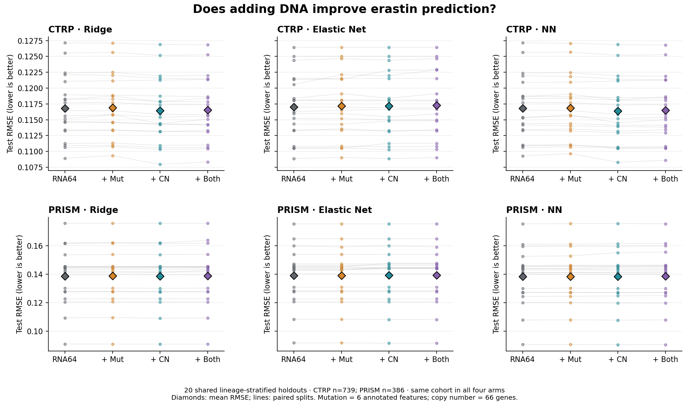
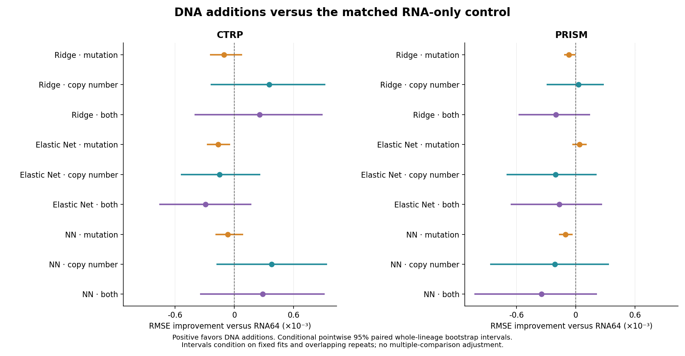

# RNA64 plus mutation and copy-number benchmark

Four arms were evaluated for ridge, Elastic Net and the retained small neural-network family on all 20 shared nested splits, separately for CTRP and PRISM. All arms retain the original 64 RNA genes. Training is unweighted and excludes culture and lineage prediction covariates. The canonical RNA-only model registry is unchanged.

**Recommendation:** retain the individual RNA-only 64-gene models as the default, and keep the CTRP copy-number model as an exploratory candidate. None of the 18 primary DNA-versus-RNA pooled-RMSE comparisons has a conditional 95% interval entirely above zero. Some CTRP secondary metrics favor copy-number additions; no clear PRISM primary-metric gain is established.

## Matched cohorts and validation

- **CTRP:** 739 of the original 744 model rows (728 identity groups), with all 23 lineages retained. Five rows lacked mutation matrix coverage. RNA-only models were refit on these same 739 rows. Their performance must not be compared directly with the historical 744-row baseline to infer a DNA effect.
- **PRISM:** all 386 original model rows (379 identity groups) and 20 lineages. The 60 original RNA-only fits and their inner/outer predictions were reused exactly.
- Original outer test masks and five inner-fold assignments were projected onto the matched cohorts without reassignment. Every evaluated lineage occurs in both outer train and test; identity groups never cross folds. This evaluates new cell lines in represented lineages, not unseen-lineage prediction.
- Scalers, mutation frequency filters, copy-number medians and constant-feature filters are fitted only on the current training fold. Hyperparameters and block scales are selected by mean five-fold inner RMSE. Outer outcomes do not participate in preprocessing or tuning.

## Held-out performance

Values are means across 20 overlapping holdouts, not independent biological replicates. RMSE is in the original assay-specific negative-AUC units; lower is better. Response values are oriented so larger means greater sensitivity.

| Assay | Family | Inputs | RMSE | Spearman | R2 | Equal-lineage RMSE |
|---|---|---|---:|---:|---:|---:|
| CTRP | Ridge | RNA64 | 0.116811 | 0.4670 | 0.2132 | 0.110465 |
| CTRP | Ridge | RNA + mutation | 0.116917 | 0.4644 | 0.2118 | 0.110404 |
| CTRP | Ridge | RNA + copy number | 0.116456 | 0.4722 | 0.2180 | 0.110013 |
| CTRP | Ridge | RNA + both | 0.116554 | 0.4701 | 0.2167 | 0.109947 |
| CTRP | Elastic Net | RNA64 | 0.117005 | 0.4668 | 0.2107 | 0.111003 |
| CTRP | Elastic Net | RNA + mutation | 0.117168 | 0.4654 | 0.2086 | 0.111120 |
| CTRP | Elastic Net | RNA + copy number | 0.117154 | 0.4641 | 0.2088 | 0.110998 |
| CTRP | Elastic Net | RNA + both | 0.117299 | 0.4627 | 0.2069 | 0.111082 |
| CTRP | NN | RNA64 | 0.116795 | 0.4675 | 0.2136 | 0.110344 |
| CTRP | NN | RNA + mutation | 0.116861 | 0.4663 | 0.2127 | 0.110242 |
| CTRP | NN | RNA + copy number | 0.116417 | 0.4727 | 0.2186 | 0.109875 |
| CTRP | NN | RNA + both | 0.116508 | 0.4712 | 0.2174 | 0.109827 |
| PRISM | Ridge | RNA64 | 0.138611 | 0.3601 | 0.0514 | 0.109207 |
| PRISM | Ridge | RNA + mutation | 0.138680 | 0.3588 | 0.0504 | 0.109200 |
| PRISM | Ridge | RNA + copy number | 0.138583 | 0.3589 | 0.0519 | 0.109316 |
| PRISM | Ridge | RNA + both | 0.138812 | 0.3511 | 0.0488 | 0.109419 |
| PRISM | Elastic Net | RNA64 | 0.139082 | 0.3491 | 0.0450 | 0.109586 |
| PRISM | Elastic Net | RNA + mutation | 0.139043 | 0.3495 | 0.0455 | 0.109526 |
| PRISM | Elastic Net | RNA + copy number | 0.139288 | 0.3355 | 0.0424 | 0.110001 |
| PRISM | Elastic Net | RNA + both | 0.139249 | 0.3359 | 0.0429 | 0.109944 |
| PRISM | NN | RNA64 | 0.138203 | 0.3616 | 0.0569 | 0.108525 |
| PRISM | NN | RNA + mutation | 0.138308 | 0.3596 | 0.0554 | 0.108551 |
| PRISM | NN | RNA + copy number | 0.138416 | 0.3549 | 0.0543 | 0.108476 |
| PRISM | NN | RNA + both | 0.138551 | 0.3535 | 0.0524 | 0.108549 |

## Paired effect of adding DNA

Positive improvement means lower RMSE than the same-family RNA-only control. Intervals are conditional pointwise 95% paired whole-lineage bootstrap intervals, with 5,000 draws. Each draw preserves all models and overlapping repeats together. They exclude retraining uncertainty and are not corrected for the multiple comparisons.

| Assay | Family | Addition | RMSE improvement [95% interval] | Relative improvement | Better splits /20 |
|---|---|---|---:|---:|---:|
| CTRP | Ridge | mutation | -0.000105 [-0.000248, 0.000079] | -0.09% | 7 |
| CTRP | Ridge | copy number | 0.000355 [-0.000241, 0.000922] | 0.30% | 19 |
| CTRP | Ridge | both | 0.000258 [-0.000402, 0.000897] | 0.22% | 17 |
| CTRP | Elastic Net | mutation | -0.000163 [-0.000280, -0.000043] | -0.14% | 4 |
| CTRP | Elastic Net | copy number | -0.000149 [-0.000543, 0.000262] | -0.13% | 10 |
| CTRP | Elastic Net | both | -0.000294 [-0.000760, 0.000172] | -0.25% | 8 |
| CTRP | NN | mutation | -0.000067 [-0.000190, 0.000091] | -0.06% | 8 |
| CTRP | NN | copy number | 0.000378 [-0.000181, 0.000940] | 0.32% | 19 |
| CTRP | NN | both | 0.000287 [-0.000347, 0.000917] | 0.25% | 18 |
| PRISM | Ridge | mutation | -0.000069 [-0.000117, -0.000004] | -0.05% | 2 |
| PRISM | Ridge | copy number | 0.000029 [-0.000296, 0.000286] | 0.02% | 11 |
| PRISM | Ridge | both | -0.000201 [-0.000581, 0.000146] | -0.14% | 9 |
| PRISM | Elastic Net | mutation | 0.000040 [-0.000033, 0.000111] | 0.03% | 1 |
| PRISM | Elastic Net | copy number | -0.000206 [-0.000701, 0.000210] | -0.15% | 5 |
| PRISM | Elastic Net | both | -0.000167 [-0.000661, 0.000268] | -0.12% | 6 |
| PRISM | NN | mutation | -0.000105 [-0.000169, -0.000032] | -0.08% | 4 |
| PRISM | NN | copy number | -0.000213 [-0.000870, 0.000336] | -0.15% | 9 |
| PRISM | NN | both | -0.000348 [-0.001027, 0.000217] | -0.25% | 5 |





## Interpretation

- **CTRP:** the lowest observed mean RMSE is 0.116417, from NN with RNA + copy number. This is an exploratory descriptive ranking across the tested arms.
  - Ridge, RNA + mutation: interval spans zero; improved in 7/20 splits.
  - Ridge, RNA + copy number: interval spans zero; improved in 19/20 splits.
  - Ridge, RNA + both: interval spans zero; improved in 17/20 splits.
  - Elastic Net, RNA + mutation: conditional interval below zero; improved in 4/20 splits.
  - Elastic Net, RNA + copy number: interval spans zero; improved in 10/20 splits.
  - Elastic Net, RNA + both: interval spans zero; improved in 8/20 splits.
  - NN, RNA + mutation: interval spans zero; improved in 8/20 splits.
  - NN, RNA + copy number: interval spans zero; improved in 19/20 splits.
  - NN, RNA + both: interval spans zero; improved in 18/20 splits.
- **PRISM:** the lowest observed mean RMSE is 0.138203, from NN with RNA64. This is an exploratory descriptive ranking across the tested arms.
  - Ridge, RNA + mutation: conditional interval below zero; improved in 2/20 splits.
  - Ridge, RNA + copy number: interval spans zero; improved in 11/20 splits.
  - Ridge, RNA + both: interval spans zero; improved in 9/20 splits.
  - Elastic Net, RNA + mutation: interval spans zero; improved in 1/20 splits.
  - Elastic Net, RNA + copy number: interval spans zero; improved in 5/20 splits.
  - Elastic Net, RNA + both: interval spans zero; improved in 6/20 splits.
  - NN, RNA + mutation: conditional interval below zero; improved in 4/20 splits.
  - NN, RNA + copy number: interval spans zero; improved in 9/20 splits.
  - NN, RNA + both: interval spans zero; improved in 5/20 splits.

Secondary metrics provide a more favorable CTRP signal than pooled RMSE. For the NN copy-number arm, the MAE improvement is 0.000691 (conditional 95% interval 0.000095 to 0.001250), and RMSE averaged equally across the larger lineages improves by 0.000595 (0.000117 to 0.001116). The NN arm with both DNA blocks improves RMSE averaged equally across all lineages by 0.000517 (0.000057 to 0.001008). These are secondary, pointwise comparisons without multiplicity adjustment. They support further evaluation of the CTRP copy-number candidate, not an established primary-metric gain.
The NN copy-number arm has lower mean per-lineage RMSE in 15/23 CTRP lineages and 10/20 PRISM lineages. Thus 19/20 favorable CTRP split results do not imply a uniform benefit across cancer types. See `lineage_effects.tsv` for effect variation and `lineage_win_counts.tsv` for compact counts. Small lineages have few test cells; their directional counts are descriptive.

## DNA definitions and coverage

All DNA data come from the official [DepMap 24Q4 Public v1 release](https://plus.figshare.com/articles/dataset/DepMap_24Q4_Public/27993248), matching the pinned RNA release. Gene symbol and Entrez columns were verified against the RNA header. Files were verified against official MD5 values and saved SHA256 checksums.

**Mutation:** six prespecified features: KEAP1 LikelyLoF, NFE2L2 hotspot, BAP1 LikelyLoF, TP53 LikelyLoF, TP53 hotspot and KRAS hotspot. Official 1/2 calls become carrier=1; finite zero remains zero. Missing data never become wild type. Genotype 2 denotes summed allele frequency above 0.95 and is not called biallelic loss. LikelyLoF/hotspot are annotation categories, not experimentally established function; TP53 categories can overlap.
Each fit requires at least five carriers and five non-carriers. Binary features are centered without variance scaling, to avoid amplifying rare carriers, and their block multiplier (1 or 2) is tuned inside inner CV. Rare classes have limited power, particularly BAP1.

| Assay | Feature | Matched-cohort carriers | Included in outer training fits /20 |
|---|---|---:|---:|
| CTRP | KEAP1_likely_lof | 17 | 20 |
| CTRP | NFE2L2_hotspot | 15 | 20 |
| CTRP | BAP1_likely_lof | 8 | 18 |
| CTRP | TP53_likely_lof | 504 | 20 |
| CTRP | TP53_hotspot | 391 | 20 |
| CTRP | KRAS_hotspot | 129 | 20 |
| PRISM | KEAP1_likely_lof | 9 | 20 |
| PRISM | NFE2L2_hotspot | 16 | 20 |
| PRISM | BAP1_likely_lof | 6 | 15 |
| PRISM | TP53_likely_lof | 265 | 20 |
| PRISM | TP53_hotspot | 209 | 20 |
| PRISM | KRAS_hotspot | 78 | 20 |

**Copy number:** the 63 available RNA genes plus KEAP1, TP53 and KRAS, for 66 features. CBS is absent from the official copy-number header and remains RNA-only; no alias is substituted. Relative copy ratios are transformed as `log2(x+1)`. No amplification, deep-deletion or biallelic state is inferred. Training medians fill missing values, training constants are removed, and standardized copy-number features receive an inner-tuned block multiplier of 0.25 or 1.
The primary cohort requires all six genotypes and at least 80% available copy-number values per sample. A copy-number feature also requires at least 80% training-fold coverage. In these matched cohorts, all selected copy-number entries are finite, so no values actually require imputation. The retained RNA64 block is always present.

## Numerical verification

A training-only preflight initially found Elastic Net convergence warnings at 50,000 iterations and in a cold native refit at 500,000. Before any production fit or outer-result inspection, fixed convergence-only retries up to 5 million iterations were added, preserving the candidate grid, objective and tolerance. The earlier protocols are archived locally; the amendment is recorded in the frozen protocol and `grid_amendment.json`. Final solver warnings still cause failure. Baseline first-fold candidate predictions and the first outer RNA-only refits were checked against the original PRISM fits. Every production outer prediction is reproduced from its saved model; all inner-fold losses, selected candidates, current-training preprocessors and file checksums are audited.

## Limits and next decision

The cohorts have been inspected repeatedly in earlier experiments, so correct nesting does not make this a fresh confirmatory study. A favorable arm needs validation on new response data or a prospective, previously untouched cohort. The two drug-screen cohorts overlap in cell lines and are not independent biological replication. Effect intervals condition on fitted models and omit training variability; 20 seed repeats are not independent cohorts.
This compact mutation panel is not a genome-wide SNV/indel search. Gene-level annotations omit allele-specific effects, zygosity and functional context. Binary mutations are centered without variance standardization and only block multipliers 1 and 2 are tested; alternative encodings and substantially larger mutation weights are not evaluated. Copy number and RNA may overlap in information. A null result applies to these feature definitions and tuning grids, not to all multi-omics models. DNA and RNA can come from different collection profiles despite release matching. Original CTRP endpoint provenance and PRISM response-processing limitations remain.

## Artifacts

- [Summary](summary.tsv)
- [Paired comparisons](paired_comparisons.tsv)
- [Coverage](coverage_summary.json)
- [Excluded lines](excluded_samples.tsv)
- [Gene mapping](gene_mapping.tsv)
- [Official DNA download links and checksums](references.json)
- [Mutation/CN feature inclusion](feature_inclusion_frequency.tsv)
- [Lineage improvement counts](lineage_win_counts.tsv)
- [Chosen settings](selected_parameters.tsv)
- [Validation](validation.json)
- [Frozen protocol](protocol.json)
- [Source checksums](source_manifest.json)

## Reproduction

Run from the repository root in the pinned scikit-learn 1.5.2 environment. The commands below verify/reuse existing checkpoints and rebuild the report on this completed workspace. Raw matrices, prepared arrays, fitted binaries and fold-level prediction arrays are ignored by Git. The source manifest records their checksums.

Initial acquisition and preparation are implemented in `download_data.py` and `prepare_data.py`. They belong before protocol freezing for a fresh experiment; do not rerun them over the frozen download manifests or prepared inputs. A fresh-environment reproduction also requires reconstructing the pinned source RNA cohorts and their saved splits/models, as documented by the retained-model registry and source manifests.

```bash
export PYTHONPATH="$PWD/work/bulkformer/packages"
export OPENBLAS_NUM_THREADS=1 OMP_NUM_THREADS=1 MKL_NUM_THREADS=1
export MPLCONFIGDIR="$PWD/work/bulkformer/matplotlib_cache"
export PYTHONDONTWRITEBYTECODE=1
PY=/home/sji/miniforge3/envs/deeplearning/bin/python
$PY outputs/erastin_rna_dna_comparison/run_benchmark.py
$PY outputs/erastin_rna_dna_comparison/review.py
```
