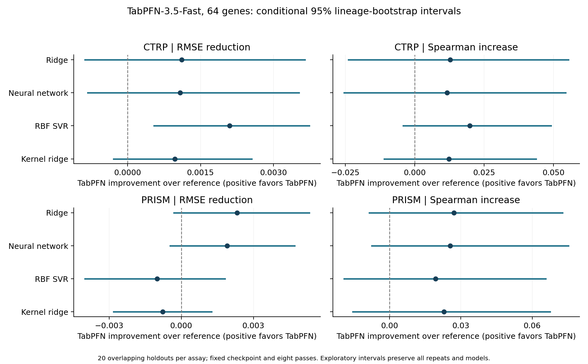

# TabPFN regression on the 64-gene panel

Fixed TabPFN-3.5-Fast checkpoint, package 9.0.0, eight ensemble passes, CPU float32 inference. The same 20 lineage-stratified identity-group holdouts per assay are reused, with unweighted gene-only training and no culture or lineage predictors. No study-specific TabPFN hyperparameter tuning was performed; saved baseline nested tuning is unchanged.

## Findings

**CTRP**
- Versus Neural network: 0.92% lower mean RMSE; favorable in 14/20 repeats and 13/23 lineages. Conditional interval includes no difference.
- Versus RBF SVR: 1.78% lower mean RMSE; favorable in 18/20 repeats and 16/23 lineages. Conditional interval favors TabPFN.
- Versus Kernel ridge: 0.83% lower mean RMSE; favorable in 16/20 repeats and 15/23 lineages. Conditional interval includes no difference.
- Versus Hierarchical gene slopes: 0.18% lower mean RMSE; favorable in 12/20 repeats and 13/23 lineages. Conditional interval includes no difference.

**PRISM**
- Versus Neural network: 1.38% lower mean RMSE; favorable in 16/20 repeats and 12/20 lineages. Conditional interval includes no difference.
- Versus RBF SVR: 0.74% higher mean RMSE; favorable in 10/20 repeats and 8/20 lineages. Conditional interval includes no difference.
- Versus Kernel ridge: 0.57% higher mean RMSE; favorable in 8/20 repeats and 12/20 lineages. Conditional interval includes no difference.
- Versus Hierarchical gene slopes: 2.15% lower mean RMSE; favorable in 19/20 repeats and 13/20 lineages. Conditional interval favors TabPFN.

## Held-out performance

| Assay | Model | RMSE | Spearman | R2 | Equal-lineage RMSE | Within-lineage centered Spearman |
|---|---|---:|---:|---:|---:|---:|
| CTRP | Ridge | 0.117005 | 0.4606 | 0.2087 | 0.110655 | 0.3023 |
| CTRP | Elastic Net | 0.117205 | 0.4600 | 0.2062 | 0.111193 | 0.3075 |
| CTRP | Neural network | 0.116968 | 0.4618 | 0.2094 | 0.110514 | 0.3057 |
| CTRP | RBF SVR | 0.117984 | 0.4536 | 0.1956 | 0.111169 | 0.2908 |
| CTRP | Kernel ridge | 0.116862 | 0.4610 | 0.2106 | 0.110573 | 0.3026 |
| CTRP | Previous random-intercept model | 0.116906 | 0.4676 | 0.2101 | 0.110172 | 0.2977 |
| CTRP | Matched intercept-only model | 0.116585 | 0.4719 | 0.2144 | 0.109862 | 0.2986 |
| CTRP | Hierarchical gene slopes | 0.116103 | 0.4674 | 0.2211 | 0.109172 | 0.2971 |
| CTRP | TabPFN-3.5-Fast (8 passes) | 0.115890 | 0.4734 | 0.2231 | 0.108696 | 0.3205 |
| CTRP | Training mean | 0.132083 | undefined | -0.0062 | 0.120777 | undefined |
| PRISM | Ridge | 0.138611 | 0.3601 | 0.0514 | 0.109207 | 0.2720 |
| PRISM | Elastic Net | 0.139082 | 0.3491 | 0.0450 | 0.109586 | 0.2574 |
| PRISM | Neural network | 0.138203 | 0.3616 | 0.0569 | 0.108525 | 0.2721 |
| PRISM | RBF SVR | 0.135287 | 0.3678 | 0.0976 | 0.104080 | 0.3158 |
| PRISM | Kernel ridge | 0.135521 | 0.3643 | 0.0921 | 0.107395 | 0.3157 |
| PRISM | Previous random-intercept model | 0.139000 | 0.3560 | 0.0462 | 0.109479 | 0.2737 |
| PRISM | Matched intercept-only model | 0.138915 | 0.3568 | 0.0473 | 0.109438 | 0.2734 |
| PRISM | Hierarchical gene slopes | 0.139288 | 0.3391 | 0.0389 | 0.110124 | 0.2553 |
| PRISM | TabPFN-3.5-Fast (8 passes) | 0.136291 | 0.3872 | 0.0818 | 0.105641 | 0.3036 |
| PRISM | Training mean | 0.144030 | undefined | -0.0286 | 0.119545 | undefined |

Values are mean per-repeat scores, not predictions averaged over overlapping outer fits.

## Paired RMSE differences

| Assay | Reference | TabPFN RMSE reduction | Conditional 95% interval | Favorable repeats |
|---|---|---:|---|---:|
| CTRP | Ridge | +0.001115 | [-0.000877, +0.003645] | 14/20 |
| CTRP | Neural network | +0.001078 | [-0.000815, +0.003524] | 14/20 |
| CTRP | RBF SVR | +0.002094 | [+0.000541, +0.003733] | 18/20 |
| CTRP | Kernel ridge | +0.000972 | [-0.000290, +0.002553] | 16/20 |
| CTRP | Elastic Net | +0.001316 | [-0.000682, +0.003798] | 16/20 |
| CTRP | Previous random-intercept model | +0.001017 | [-0.000815, +0.003322] | 13/20 |
| CTRP | Matched intercept-only model | +0.000695 | [-0.001071, +0.002824] | 11/20 |
| CTRP | Hierarchical gene slopes | +0.000213 | [-0.001844, +0.002405] | 12/20 |
| PRISM | Ridge | +0.002320 | [-0.000311, +0.005320] | 17/20 |
| PRISM | Neural network | +0.001912 | [-0.000463, +0.004714] | 16/20 |
| PRISM | RBF SVR | -0.001004 | [-0.004008, +0.001812] | 10/20 |
| PRISM | Kernel ridge | -0.000770 | [-0.002813, +0.001265] | 8/20 |
| PRISM | Elastic Net | +0.002791 | [-0.000008, +0.005854] | 18/20 |
| PRISM | Previous random-intercept model | +0.002708 | [+0.000143, +0.005775] | 17/20 |
| PRISM | Matched intercept-only model | +0.002624 | [+0.000100, +0.005617] | 17/20 |
| PRISM | Hierarchical gene slopes | +0.002997 | [+0.000456, +0.006314] | 19/20 |

## Protocol and validation

- CTRP: unchanged 744 lines, 733 identity groups and 23 lineages. PRISM: unchanged 386 lines, 379 groups and 20 lineages. Every evaluated lineage remains in training and testing; identities are disjoint. CTRP Cervix remains excluded and Ampulla handling unchanged.
- Official checkpoint pinned by Hugging Face repository revision and SHA256. CPU-only timing, without accuracy, selected 3.5-Fast over the slower v2 pilot. The version and eight-pass setting were fixed before benchmarking.
- Native feature and response preprocessing fits on outer-training rows only. No external all-cohort scaling. Query-subset and changed-neighbor checks verify that held-out rows do not fit context statistics. Only training responses are passed to fit; predict receives RNA only.
- Fixed configuration has no inner search or temperature calibration. Original inner assignments are preserved and audited but are not used for this untuned model. This differs from the baselines, whose existing nested tuning is reused.
- Forty native fitted-context archives are saved without duplicating the pretrained weights. All archive CRCs, checksums, train/test rows, native target-training statistics and 64-feature coverage were checked. First and last contexts in each assay were restored and their full test predictions reproduced; other archives were integrity-checked, not separately replayed.
- TabPFN runs in an isolated dependency environment. Baseline evaluation uses the original pinned environment. Local weights and blocked network connections ensure inference does not call a hosted prediction service.
- Three hundred twenty baseline model contexts are represented by verified, unchanged source predictions. Baseline summary metrics were reproduced. Whole-lineage paired bootstrap keeps all models and all 20 repeats together.
- Intervals are exploratory, conditional and not multiplicity adjusted; overlapping repeats are not independent cohorts. The repeatedly inspected data need fresh confirmation. No patient or unseen-lineage claim is made.
- Results concern this 3.5-Fast checkpoint, not every TabPFN version or tuning strategy. Pretraining-corpus overlap with these pharmacogenomic datasets has not been independently audited. Original harmonized CTRP AUC provenance remains unresolved. Retained registry unchanged.

Sources: [official implementation](https://github.com/PriorLabs/TabPFN), [3.5 model card](https://huggingface.co/Prior-Labs/tabpfn_3_5), [original TabPFN small-data study](https://www.nature.com/articles/s41586-024-08328-6). The original study concerns an earlier model generation. Checkpoint license is saved separately.
