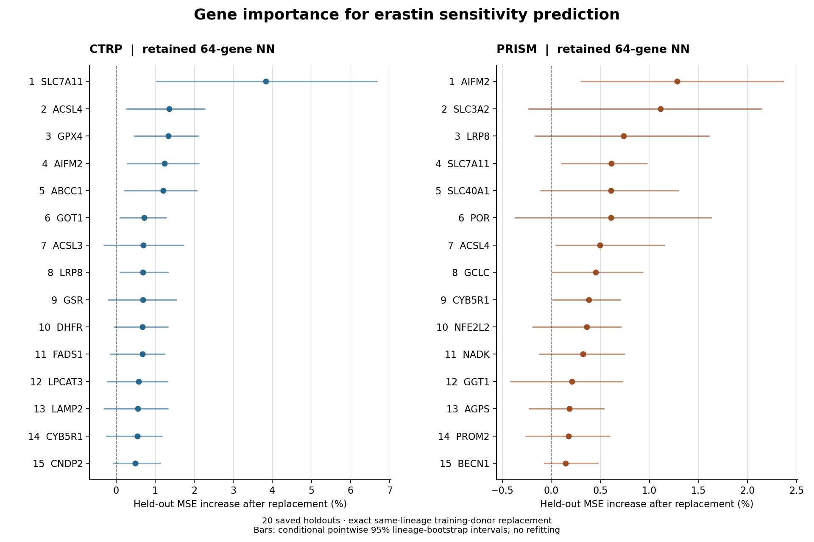

# All 64 genes in the retained neural network models

The retained panel contains **64 genes**. These rankings use the exact retained, unweighted, expression-only CTRP and PRISM neural networks, separately. No new model was trained, no genes were selected or removed, and the retained-model registry was not changed.

## How to read the rankings

**Primary rank: held-out predictive importance.** For each held-out cell, replace one gene's expression with every outer-training donor value from the same lineage, keeping the other 63 genes fixed. Average squared-error changes over donors and receiver cells, then over the 20 saved lineage-stratified holdouts. Train/test identity groups are disjoint. All evaluated lineages occur in both train and test; this is a within-lineage generalization benchmark.

**Importance (%) = 100 × mean increase in held-out MSE / mean baseline held-out MSE.** Larger positive values indicate greater useful reliance by this fitted model. Values do not sum to 100%, are not explained variance, and cannot be added to predict the benefit of a smaller panel. Negative values mean replacement improved held-out error under this procedure; they do not imply that a gene lacks ferroptosis relevance.

**Secondary rank: effective input sensitivity.** A neural network has many hidden weights for each input; there is no single coefficient per gene. The gradient ranking uses the root mean square of the derivative of the three-member ensemble prediction with respect to standardized expression, evaluated on held-out cells across all 20 fits. Member gradients are averaged before taking magnitudes. Slopes are in original negative-AUC units per training-set expression SD. This incorporates all layers and activation functions. It measures how strongly expression changes the prediction, rather than whether that change is useful.

The target is **negative erastin AUC** in both cohorts. Thus a positive signed slope means higher expression predicts greater erastin sensitivity; a negative slope means lower predicted sensitivity. Directions are local model associations with all other inputs held fixed, not experimental gene perturbations.

## Main findings

CTRP's top five genes are SLC7A11, ACSL4, GPX4, AIFM2 and ABCC1. PRISM's top five are AIFM2, SLC3A2, LRP8, SLC7A11 and SLC40A1. SLC7A11, AIFM2 and ACSL4 have positive pointwise lower uncertainty bounds in both cohorts. LRP8 is also top ten in both, but its PRISM interval includes zero.

Cross-assay predictive-rank Spearman correlation is **0.245**. GPX4 ranks 3rd in CTRP versus 48th in PRISM; ABCC1 ranks 5th versus 27th. Their CTRP prominence is not reproduced by the PRISM model. Cohorts overlap in cell lines and differ in assay, response processing, sample composition and fitted models; rank differences cannot be assigned solely to assay biology.

CTRP: genes with a positive pointwise lower 95% bound are **SLC7A11, ACSL4, GPX4, AIFM2, ABCC1, GOT1, LRP8**. Median pairwise predictive-rank correlation across lineages with at least 10 cohort cells is 0.031. Importance is therefore not a universal lineage ranking.

PRISM: genes with a positive pointwise lower 95% bound are **AIFM2, SLC7A11, ACSL4, GCLC, CYB5R1**. Median pairwise predictive-rank correlation across lineages with at least 10 cohort cells is 0.038. Importance is therefore not a universal lineage ranking.



## Ranking by effective NN input sensitivity

RMS standardized gradient is the weights-like measure described above, in negative-AUC units per expression SD. It has no sign; the predictive tables below and CSVs supply signed directions. The two importance definitions can disagree: HDDC3 ranks 7th by PRISM gradient magnitude but 54th by predictive importance. A strong effect on predictions can be unhelpful for predicting the measured response.

| Gradient rank | CTRP gene | CTRP RMS gradient | PRISM gene | PRISM RMS gradient |
|---:|---|---:|---|---:|
| 1 | SLC7A11 | 0.014856 | AIFM2 | 0.007258 |
| 2 | ACSL4 | 0.010091 | SLC3A2 | 0.006903 |
| 3 | AIFM2 | 0.008580 | LRP8 | 0.005255 |
| 4 | GPX4 | 0.008394 | GGT1 | 0.005168 |
| 5 | ABCC1 | 0.008222 | POR | 0.004882 |
| 6 | CYB5R1 | 0.008114 | ACSL4 | 0.004347 |
| 7 | ACSL3 | 0.007833 | HDDC3 | 0.004339 |
| 8 | LAMP2 | 0.007546 | FADS2 | 0.004205 |
| 9 | CTSD | 0.007135 | SLC40A1 | 0.004117 |
| 10 | GSR | 0.007059 | SLC7A11 | 0.003771 |

## Complete predictive ranking

Interval = conditional pointwise 95% whole-lineage bootstrap interval for relative MSE increase. Positive / top-10 counts refer to the 20 overlapping saved holdouts; top-10 counts also require positive importance. Lineage counts are positive importance among lineages with at least 10 cohort cells (19 CTRP; 13 PRISM). Higher / lower refers to predicted sensitivity when expression rises. The complete CSVs additionally contain signed and RMS slopes, direction agreement, rank ranges, and common-lineage summaries.

### CTRP

| Rank | Gene | MSE increase % [95% interval] | Higher expression predicts | Positive /20 | Top 10 /20 | Positive lineages | Gradient rank |
|---:|---|---:|---|---:|---:|---:|---:|
| 1 | SLC7A11 | 3.837 [1.022, 6.682] | lower sensitivity | 20 | 20 | 13/19 | 1 |
| 2 | ACSL4 | 1.364 [0.255, 2.284] | higher sensitivity | 18 | 14 | 12/19 | 2 |
| 3 | GPX4 | 1.338 [0.454, 2.117] | lower sensitivity | 18 | 15 | 14/19 | 4 |
| 4 | AIFM2 | 1.236 [0.277, 2.127] | lower sensitivity | 18 | 16 | 14/19 | 3 |
| 5 | ABCC1 | 1.207 [0.199, 2.084] | higher sensitivity | 18 | 16 | 14/19 | 5 |
| 6 | GOT1 | 0.716 [0.090, 1.292] | higher sensitivity | 17 | 11 | 12/19 | 15 |
| 7 | ACSL3 | 0.700 [-0.323, 1.740] | lower sensitivity | 18 | 8 | 11/19 | 7 |
| 8 | LRP8 | 0.692 [0.086, 1.352] | lower sensitivity | 16 | 11 | 13/19 | 12 |
| 9 | GSR | 0.688 [-0.211, 1.555] | lower sensitivity | 17 | 9 | 11/19 | 10 |
| 10 | DHFR | 0.680 [-0.059, 1.340] | higher sensitivity | 18 | 11 | 13/19 | 18 |
| 11 | FADS1 | 0.675 [-0.155, 1.256] | higher sensitivity | 17 | 9 | 14/19 | 13 |
| 12 | LPCAT3 | 0.583 [-0.236, 1.329] | higher sensitivity | 16 | 7 | 11/19 | 16 |
| 13 | LAMP2 | 0.562 [-0.326, 1.333] | lower sensitivity | 17 | 9 | 10/19 | 8 |
| 14 | CYB5R1 | 0.542 [-0.252, 1.185] | lower sensitivity | 15 | 11 | 14/19 | 6 |
| 15 | CNDP2 | 0.496 [-0.080, 1.144] | higher sensitivity | 17 | 6 | 11/19 | 20 |
| 16 | CTSD | 0.374 [-0.499, 1.112] | lower sensitivity | 14 | 8 | 9/19 | 9 |
| 17 | FADS2 | 0.349 [-0.408, 0.874] | higher sensitivity | 15 | 4 | 11/19 | 19 |
| 18 | FAR1 | 0.318 [-0.040, 0.603] | higher sensitivity | 17 | 2 | 9/19 | 25 |
| 19 | GCLC | 0.267 [-0.564, 1.087] | lower sensitivity | 14 | 4 | 9/19 | 11 |
| 20 | POR | 0.261 [-0.261, 0.699] | lower sensitivity | 16 | 1 | 12/19 | 21 |
| 21 | BECN1 | 0.213 [-0.247, 0.788] | higher sensitivity | 16 | 4 | 9/19 | 27 |
| 22 | SLC3A2 | 0.203 [-0.621, 1.006] | lower sensitivity | 15 | 2 | 11/19 | 14 |
| 23 | CTNS | 0.164 [-0.469, 0.815] | lower sensitivity | 13 | 1 | 8/19 | 24 |
| 24 | MBOAT2 | 0.163 [-0.143, 0.514] | higher sensitivity | 14 | 0 | 9/19 | 29 |
| 25 | IREB2 | 0.158 [-0.519, 0.711] | higher sensitivity | 14 | 0 | 12/19 | 28 |
| 26 | AGPS | 0.127 [-0.302, 0.547] | lower sensitivity | 15 | 0 | 11/19 | 26 |
| 27 | MBOAT1 | 0.089 [-0.337, 0.437] | lower sensitivity | 12 | 0 | 10/19 | 23 |
| 28 | SREBF1 | 0.087 [-0.317, 0.533] | lower sensitivity | 12 | 0 | 11/19 | 32 |
| 29 | AGPAT3 | 0.084 [-0.384, 0.525] | higher sensitivity | 15 | 0 | 15/19 | 33 |
| 30 | ATF4 | 0.074 [-0.347, 0.475] | higher sensitivity | 15 | 1 | 9/19 | 22 |
| 31 | SEPHS2 | 0.072 [-0.053, 0.203] | higher sensitivity | 17 | 0 | 11/19 | 47 |
| 32 | NADK | -0.000 [-0.210, 0.212] | higher sensitivity | 11 | 0 | 11/19 | 42 |
| 33 | FTH1 | -0.022 [-0.216, 0.170] | higher sensitivity | 11 | 0 | 11/19 | 38 |
| 34 | GNPAT | -0.026 [-0.218, 0.175] | higher sensitivity | 10 | 0 | 10/19 | 37 |
| 35 | GCLM | -0.033 [-0.148, 0.079] | higher sensitivity | 8 | 0 | 9/19 | 59 |
| 36 | SCD | -0.034 [-0.219, 0.123] | higher sensitivity | 8 | 0 | 7/19 | 56 |
| 37 | NCOA4 | -0.036 [-0.121, 0.052] | lower sensitivity | 6 | 0 | 10/19 | 61 |
| 38 | SLC40A1 | -0.048 [-0.281, 0.142] | lower sensitivity | 8 | 0 | 6/19 | 40 |
| 39 | HSPA8 | -0.053 [-0.155, 0.059] | lower sensitivity | 4 | 0 | 6/19 | 64 |
| 40 | GGT1 | -0.054 [-0.138, 0.014] | lower sensitivity | 8 | 0 | 7/19 | 63 |
| 41 | PRDX6 | -0.060 [-0.284, 0.191] | lower sensitivity | 13 | 0 | 9/19 | 34 |
| 42 | ATF3 | -0.063 [-0.205, 0.077] | higher sensitivity | 10 | 0 | 9/19 | 45 |
| 43 | NFE2L2 | -0.067 [-0.128, -0.001] | lower sensitivity | 6 | 0 | 8/19 | 60 |
| 44 | CKB | -0.072 [-0.160, 0.012] | lower sensitivity | 5 | 0 | 7/19 | 57 |
| 45 | GSS | -0.074 [-0.338, 0.147] | lower sensitivity | 8 | 0 | 10/19 | 35 |
| 46 | MBOAT7 | -0.081 [-0.205, 0.024] | higher sensitivity | 4 | 0 | 9/19 | 52 |
| 47 | BAP1 | -0.083 [-0.587, 0.461] | lower sensitivity | 11 | 0 | 9/19 | 31 |
| 48 | SPR | -0.086 [-0.354, 0.142] | lower sensitivity | 11 | 0 | 10/19 | 30 |
| 49 | GLS2 | -0.087 [-0.193, 0.013] | lower sensitivity | 5 | 0 | 9/19 | 55 |
| 50 | CTH | -0.091 [-0.171, -0.013] | higher sensitivity | 5 | 0 | 7/19 | 54 |
| 51 | PLA2G6 | -0.100 [-0.243, 0.019] | lower sensitivity | 7 | 0 | 8/19 | 48 |
| 52 | NFE2L1 | -0.101 [-0.156, -0.040] | lower sensitivity | 6 | 0 | 3/19 | 62 |
| 53 | NGLY1 | -0.114 [-0.188, -0.037] | lower sensitivity | 6 | 0 | 2/19 | 53 |
| 54 | ABHD12 | -0.117 [-0.305, 0.075] | lower sensitivity | 12 | 0 | 8/19 | 39 |
| 55 | TMEM164 | -0.124 [-0.195, -0.051] | lower sensitivity | 4 | 0 | 4/19 | 58 |
| 56 | ELOVL5 | -0.134 [-0.356, 0.027] | higher sensitivity | 6 | 0 | 6/19 | 51 |
| 57 | STARD7 | -0.136 [-0.231, -0.034] | lower sensitivity | 6 | 0 | 7/19 | 50 |
| 58 | PROM2 | -0.141 [-0.679, 0.384] | lower sensitivity | 8 | 0 | 7/19 | 17 |
| 59 | GCH1 | -0.143 [-0.287, 0.007] | lower sensitivity | 5 | 0 | 8/19 | 43 |
| 60 | CBS | -0.164 [-0.337, -0.017] | higher sensitivity | 3 | 0 | 6/19 | 44 |
| 61 | TFRC | -0.169 [-0.257, -0.075] | higher sensitivity | 4 | 0 | 3/19 | 49 |
| 62 | HDDC3 | -0.183 [-0.457, 0.012] | lower sensitivity | 8 | 0 | 7/19 | 36 |
| 63 | NFS1 | -0.205 [-0.322, -0.067] | lower sensitivity | 5 | 0 | 4/19 | 41 |
| 64 | PTS | -0.231 [-0.326, -0.107] | lower sensitivity | 2 | 0 | 5/19 | 46 |

[Complete CTRP predictive ranking](ctrp_64_gene_ranking.csv) · [CTRP gradient-sorted ranking](ctrp_64_gene_gradient_ranking.csv)

### PRISM

| Rank | Gene | MSE increase % [95% interval] | Higher expression predicts | Positive /20 | Top 10 /20 | Positive lineages | Gradient rank |
|---:|---|---:|---|---:|---:|---:|---:|
| 1 | AIFM2 | 1.284 [0.295, 2.373] | lower sensitivity | 18 | 17 | 8/13 | 1 |
| 2 | SLC3A2 | 1.112 [-0.241, 2.145] | lower sensitivity | 18 | 16 | 9/13 | 2 |
| 3 | LRP8 | 0.738 [-0.175, 1.613] | lower sensitivity | 17 | 15 | 9/13 | 3 |
| 4 | SLC7A11 | 0.614 [0.101, 0.979] | lower sensitivity | 19 | 17 | 9/13 | 10 |
| 5 | SLC40A1 | 0.609 [-0.115, 1.299] | lower sensitivity | 18 | 17 | 9/13 | 9 |
| 6 | POR | 0.607 [-0.377, 1.637] | lower sensitivity | 19 | 15 | 8/13 | 5 |
| 7 | ACSL4 | 0.497 [0.043, 1.159] | higher sensitivity | 19 | 13 | 8/13 | 6 |
| 8 | GCLC | 0.451 [0.001, 0.935] | lower sensitivity | 17 | 10 | 7/13 | 11 |
| 9 | CYB5R1 | 0.383 [0.005, 0.707] | lower sensitivity | 20 | 12 | 10/13 | 23 |
| 10 | NFE2L2 | 0.361 [-0.194, 0.716] | lower sensitivity | 19 | 10 | 9/13 | 16 |
| 11 | NADK | 0.325 [-0.128, 0.750] | lower sensitivity | 15 | 9 | 8/13 | 13 |
| 12 | GGT1 | 0.212 [-0.420, 0.727] | higher sensitivity | 14 | 9 | 9/13 | 4 |
| 13 | AGPS | 0.185 [-0.229, 0.544] | lower sensitivity | 17 | 5 | 6/13 | 20 |
| 14 | PROM2 | 0.177 [-0.267, 0.597] | higher sensitivity | 17 | 6 | 8/13 | 17 |
| 15 | BECN1 | 0.147 [-0.076, 0.477] | higher sensitivity | 16 | 5 | 8/13 | 25 |
| 16 | GSR | 0.131 [-0.142, 0.350] | lower sensitivity | 13 | 3 | 8/13 | 31 |
| 17 | SCD | 0.080 [-0.293, 0.331] | lower sensitivity | 15 | 0 | 8/13 | 32 |
| 18 | AGPAT3 | 0.076 [-0.277, 0.592] | higher sensitivity | 12 | 2 | 6/13 | 19 |
| 19 | TFRC | 0.051 [-0.617, 0.606] | lower sensitivity | 15 | 5 | 8/13 | 14 |
| 20 | STARD7 | 0.047 [-0.392, 0.482] | lower sensitivity | 12 | 0 | 7/13 | 24 |
| 21 | PTS | 0.045 [-0.397, 0.366] | lower sensitivity | 15 | 0 | 6/13 | 21 |
| 22 | DHFR | 0.042 [-0.278, 0.273] | higher sensitivity | 13 | 1 | 8/13 | 26 |
| 23 | FADS2 | 0.038 [-0.596, 0.754] | higher sensitivity | 12 | 3 | 8/13 | 8 |
| 24 | PLA2G6 | 0.034 [-0.193, 0.239] | lower sensitivity | 13 | 0 | 9/13 | 30 |
| 25 | SREBF1 | 0.028 [-0.299, 0.360] | lower sensitivity | 12 | 0 | 7/13 | 27 |
| 26 | ELOVL5 | 0.025 [-0.138, 0.218] | higher sensitivity | 12 | 2 | 7/13 | 18 |
| 27 | ABCC1 | 0.011 [-0.208, 0.209] | lower sensitivity | 14 | 0 | 7/13 | 34 |
| 28 | FTH1 | 0.008 [-0.172, 0.132] | lower sensitivity | 11 | 0 | 6/13 | 45 |
| 29 | ACSL3 | 0.004 [-0.773, 0.562] | lower sensitivity | 13 | 2 | 7/13 | 12 |
| 30 | GOT1 | 0.001 [-0.272, 0.265] | lower sensitivity | 9 | 0 | 8/13 | 28 |
| 31 | GCH1 | -0.015 [-0.187, 0.200] | lower sensitivity | 14 | 0 | 4/13 | 36 |
| 32 | GCLM | -0.016 [-0.240, 0.146] | lower sensitivity | 15 | 0 | 7/13 | 40 |
| 33 | CTSD | -0.021 [-0.214, 0.190] | lower sensitivity | 10 | 0 | 6/13 | 35 |
| 34 | GSS | -0.027 [-0.162, 0.093] | higher sensitivity | 10 | 0 | 6/13 | 55 |
| 35 | PRDX6 | -0.029 [-0.132, 0.089] | higher sensitivity | 8 | 0 | 8/13 | 63 |
| 36 | MBOAT1 | -0.032 [-0.174, 0.092] | higher sensitivity | 9 | 0 | 5/13 | 52 |
| 37 | BAP1 | -0.032 [-0.063, -0.008] | higher sensitivity | 6 | 0 | 3/13 | 64 |
| 38 | SEPHS2 | -0.039 [-0.225, 0.175] | higher sensitivity | 10 | 0 | 8/13 | 42 |
| 39 | ABHD12 | -0.043 [-0.182, 0.075] | higher sensitivity | 10 | 0 | 7/13 | 58 |
| 40 | FAR1 | -0.053 [-0.196, 0.116] | higher sensitivity | 11 | 0 | 6/13 | 41 |
| 41 | SPR | -0.066 [-0.283, 0.162] | higher sensitivity | 10 | 0 | 7/13 | 37 |
| 42 | GLS2 | -0.070 [-0.260, 0.104] | lower sensitivity | 10 | 0 | 4/13 | 43 |
| 43 | CKB | -0.072 [-0.253, 0.065] | lower sensitivity | 9 | 0 | 5/13 | 49 |
| 44 | IREB2 | -0.075 [-0.157, 0.020] | lower sensitivity | 8 | 0 | 3/13 | 60 |
| 45 | MBOAT7 | -0.083 [-0.246, 0.050] | higher sensitivity | 6 | 0 | 6/13 | 51 |
| 46 | TMEM164 | -0.088 [-0.141, -0.025] | higher sensitivity | 4 | 0 | 4/13 | 61 |
| 47 | NFS1 | -0.090 [-0.667, 0.484] | lower sensitivity | 10 | 1 | 7/13 | 15 |
| 48 | GPX4 | -0.093 [-0.199, -0.004] | lower sensitivity | 3 | 0 | 3/13 | 57 |
| 49 | LAMP2 | -0.094 [-0.299, 0.065] | lower sensitivity | 9 | 0 | 3/13 | 44 |
| 50 | NCOA4 | -0.095 [-0.180, -0.007] | higher sensitivity | 3 | 0 | 4/13 | 62 |
| 51 | CTH | -0.105 [-0.399, 0.174] | higher sensitivity | 12 | 0 | 6/13 | 22 |
| 52 | CTNS | -0.106 [-0.279, 0.042] | higher sensitivity | 4 | 0 | 7/13 | 50 |
| 53 | NGLY1 | -0.108 [-0.227, 0.033] | higher sensitivity | 4 | 0 | 6/13 | 59 |
| 54 | HDDC3 | -0.115 [-0.633, 0.276] | lower sensitivity | 10 | 5 | 6/13 | 7 |
| 55 | CNDP2 | -0.123 [-0.253, 0.016] | higher sensitivity | 5 | 0 | 5/13 | 46 |
| 56 | CBS | -0.127 [-0.337, 0.061] | higher sensitivity | 8 | 0 | 4/13 | 29 |
| 57 | MBOAT2 | -0.134 [-0.257, -0.059] | higher sensitivity | 1 | 0 | 3/13 | 56 |
| 58 | HSPA8 | -0.143 [-0.437, 0.154] | higher sensitivity | 9 | 0 | 6/13 | 33 |
| 59 | FADS1 | -0.151 [-0.283, 0.042] | higher sensitivity | 6 | 0 | 4/13 | 38 |
| 60 | NFE2L1 | -0.160 [-0.269, -0.079] | higher sensitivity | 6 | 0 | 4/13 | 53 |
| 61 | ATF3 | -0.161 [-0.298, -0.001] | higher sensitivity | 3 | 0 | 4/13 | 48 |
| 62 | ATF4 | -0.163 [-0.305, -0.043] | higher sensitivity | 2 | 0 | 5/13 | 54 |
| 63 | GNPAT | -0.183 [-0.343, -0.003] | higher sensitivity | 6 | 0 | 5/13 | 47 |
| 64 | LPCAT3 | -0.229 [-0.451, -0.034] | lower sensitivity | 7 | 0 | 4/13 | 39 |

[Complete PRISM predictive ranking](prism_64_gene_ranking.csv) · [PRISM gradient-sorted ranking](prism_64_gene_gradient_ranking.csv)

## Interpretation limits and checks

Intervals use the existing 5,000 whole-lineage bootstrap draws with models, donors and panel fixed. They are not corrected for multiple genes or previous model/panel comparisons and do not include retraining uncertainty. Twenty overlapping holdouts are not independent biological replications. Treat these as exploratory explanations of the retained models, rather than a fresh gene-discovery test.

Replacement is marginal within lineage and can disrupt correlations between a gene and the other inputs. Correlated genes can share or mask importance. Gene importance describes a particular fitted model rather than an intrinsic gene property; see the [official scikit-learn explanation](https://scikit-learn.org/1.5/modules/permutation_importance.html). Our donor replacement is exhaustive training-donor replacement, not a call to sklearn's random permutation routine.

Validation checks exact registry and source hashes; all 40 saved ensembles and their train/test IDs; all 64 gene orders; all held-out predictions and analytic ensemble gradients; finite-difference derivatives and direct exhaustive donor replacement for all 64 genes in one receiver from each cohort's first and last holdout; aggregate predictive ranks; gradient ranks; split stability counts; and the saved relative bootstrap intervals. The original importance analysis also validated donor identity exclusions and its complete replacement calculation. See [validation.json](validation.json).

Files: [both cohorts side by side](CTRP_PRISM_64_gene_comparison.csv), [per-lineage effects](per_lineage_importance.csv), [per-split effects](per_split_importance.csv), [all-64 figure](all64_predictive_importance.png), [source hashes](source_manifest.json).

Reproduce from the project root with the original pinned Python environment:

```bash
PYTHONPATH="$PWD/work/bulkformer/packages" OPENBLAS_NUM_THREADS=1 OMP_NUM_THREADS=1 \
MPLCONFIGDIR="$PWD/work/bulkformer/matplotlib_cache" PYTHONDONTWRITEBYTECODE=1 \
/home/sji/miniforge3/envs/deeplearning/bin/python outputs/retained_nn_gene_ranking/rank_genes.py
```

Generated UTC: 2026-11-02T21:26:23+00:00
